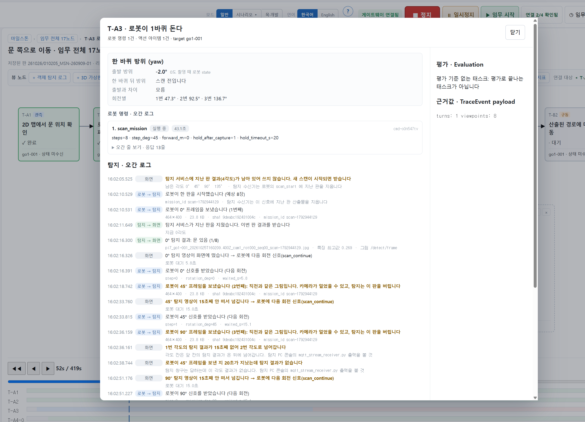
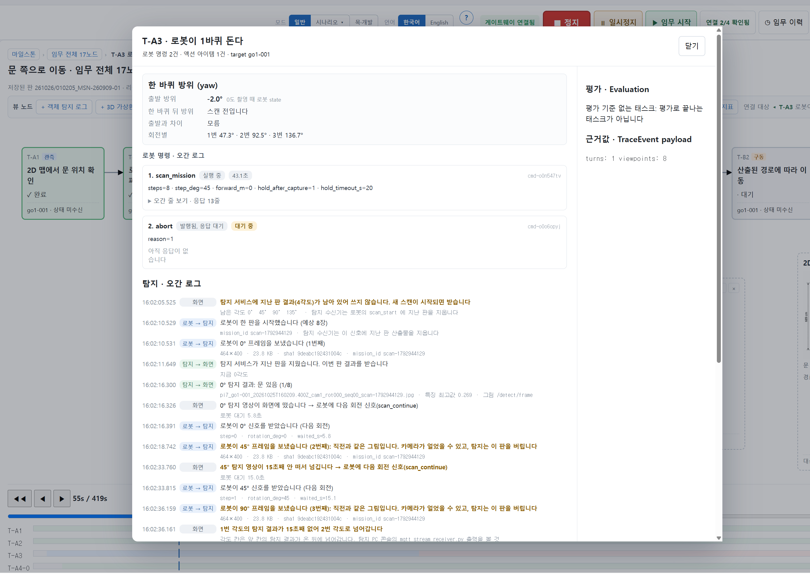
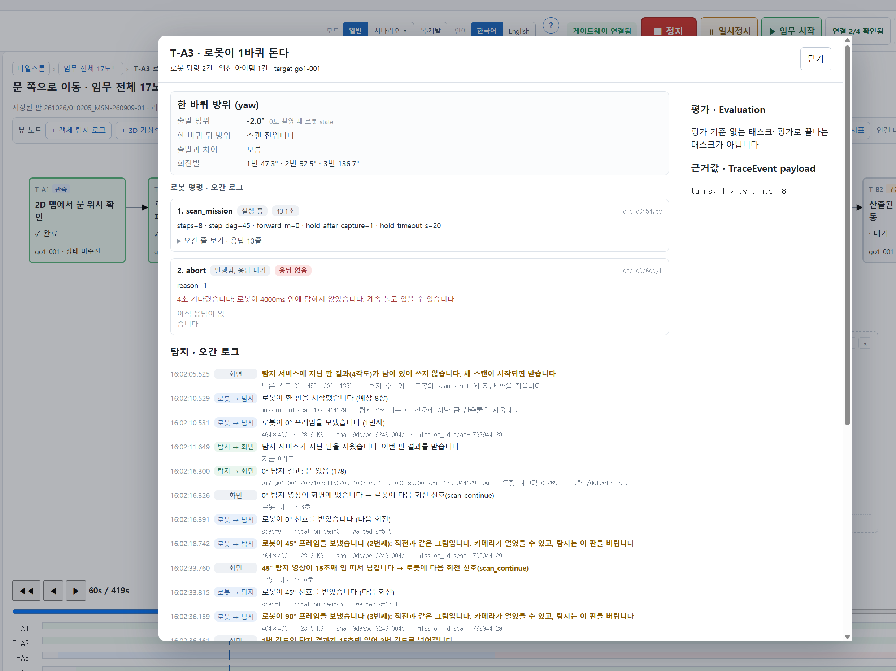
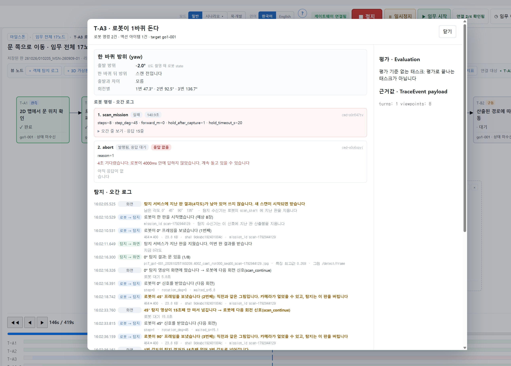
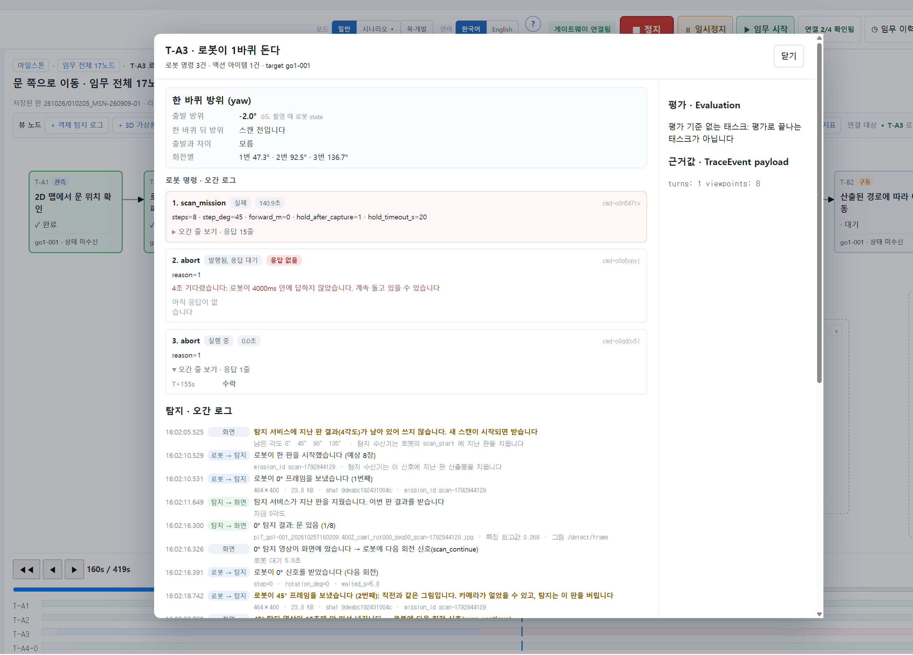

# 작업 보고: 대본 사건과 무응답 — 1부 고침 · 2부 무응답 실물 확인

**날짜**: 2026-10-25(1부) · 2026-10-26(2부 실물)
**지시**: `documents/작업프롬프트/작업프롬프트_대본사건과무응답_261025.md` 1부 · 2부
**선행**: 액션 층 시각(1부 `2f1936a` · 2부 `b55ae65` · 손보기 `167bf7e` · 3-3 `32c2b68`)
**상태**: 1부 조사·보고 → 결정 넷을 받아 1부를 고쳤다(`99dcea4`). 2부 무응답 실물 — 1·2차 판에서 명령 대상 결함을 찾아 고치고(`5aebd05`) 3차 판 `261026/010205_MSN-260909-01` 에서 **`expired` 를 실물로 기록 · 화면 사진 다섯 장**

> 한 줄 요약 — 로봇이 모는 판에서 `feedLocalTrace()` 는 **아예 안 불린다.** 그래서 대본 사건 54건 중
> **0건**이 들어온다. 그중 진짜로 빠진 것은 생성 사건(`created`) 17건이고, 나머지 37건은 라이브 경로가
> 제 모양으로 대신 적는 진행 사건이라 넣으면 안 된다. 태스크의 첫 상태 `pending` 은 **기록이 아니라
> 코드 기본값**(접기의 씨앗)에서 나온다 — 그래서 화면은 지금도 대기부터 그리고, 기록만 읽는 쪽(Foxglove)은
> `running` 부터 그린다. **지시서의 전제 하나가 틀렸다: §5-2 의 분모는 태스크 층을 포함한다.** 생성 사건을
> 넣으면 분모 중앙이 **75 → 92** 로 움직인다. 되감기는 한 점도 안 바뀐다.

---

## 0절 — 기준선

| 확인 | 결과 |
|---|---|
| 검사 | `verify:*` **118종** · 착수 전 전종 **117 초록 · 1 빨강**(`verify:fake-device` 「착륙 뒤에도 arm 상태다」). 혼자 다시 돌려도 두 번 중 한 번 빨갛다 — 전종 부하가 아니라 **그 검사 자체가 흔들린다.** 10/25 3-3 때도 같은 줄이었다. 이번 범위(대본 사건)와 무관하고 손대지 않았다 |
| 보관 판 | 118판 — 지시서 0절의 실측을 다시 세지 않았다(지시) |
| 작업 트리 | 생성기 3단계(10/23) 변경이 아직 커밋 전이다. 이번 조사와 겹치는 파일은 없다 |

---

## 1절 — 무엇이 얼마나 샜나 (보고 1)

### 대본 한 편의 사건 — 종류별

| 대본 | 사건 | `created`·pending | `started`·running | `progress`·running | `evaluated`·done | `evaluated`·awaiting_evaluation |
|---|---:|---:|---:|---:|---:|---:|
| `MSN-260909-01` (문 찾기 · 로봇이 민다) | 54 | 17 | 9 | 8 | 17 | 3 |
| `MSN-260929-02` (장치 두 대 · 타이머) | 47 | 15 | 15 | 0 | 15 | 2 |

두 대본 모두 `created` 는 전부 **0초**이고 `producedBy: backend` 다. 대본에는 이 밖에 `viewpointTimeline`(문 찾기 17칸)과 액션 아이템(태스크 셋)이 있다 — 이 둘도 `feedLocalTrace()` 가 펴는데, **로봇이 붙어 있으면 일부러 안 편다**(`if (!robotDrives())` · 260910 — 대본과 로봇이 같이 채우면 두 벌이 뜬다). 그 둘은 샌 것이 아니다.

### 같은 편 실물 판에 무엇이 들어왔나

**문 찾기 `MSN-260909-01` — 로봇이 모는 판 셋** (`261025/211950` · `261021/111532` · `260921/114930`, 셋이 같은 모양)

| 종류·상태 | 대본 | 실물 판 | 대본 사건이 들어왔나 | 실물에서 그 자리는 |
|---|---:|---:|---|---|
| `created`·pending | 17 | **0** | **안 들어옴** | **비어 있다** — 이것이 샌 것이다 |
| `started`·running | 9 | 8 | 안 들어옴 | 라이브 경로가 제 사건으로 적는다(T-A5 · T-A6 · T-C1 은 시작 없이 끝으로 간다) |
| `progress`·running | 8 | 0 | 안 들어옴 | 각도 칸은 탐지가 `evaluated`·done 으로 바로 적는다 |
| `evaluated`·done | 17 | 19 | 안 들어옴 | 라이브 경로가 적는다 |
| `evaluated`·awaiting_evaluation | 3 | 0 | 안 들어옴 | **로봇 판에는 「평가 대기」 상태가 없다** — 바로 done 으로 판정한다 |
| **태스크 층 전체** | 54 | 27 | **대본 사건 0건**(seq 가 전부 라이브 대역 ≥ 2,000,000) | |
| **노드별 첫 상태** | | | | **running 6 · done 11 · pending 0** |

**장치 두 대 `MSN-260929-02` — 타이머가 모는 판** (`260930/095326`)

| 종류·상태 | 대본 | 실물 판 |
|---|---:|---:|
| `created`·pending | 15 | **15** (대본 대역 seq < 1,000,000 — 대본 사건 그대로) |
| `started` · `evaluated` | 32 | 32 (라이브 대역 — 실행기가 적는다) |
| **노드별 첫 상태** | | **pending 15** |

### 읽는 법 — 샌 것은 하나, 나머지는 빠져야 맞다

대본 사건은 두 종류다. **계획의 사실**(`created` — 이 태스크가 이 임무에 있다)과 **진행의 이야기**(`started` · `progress` · `evaluated` — 대본 저자가 적어 둔 예정된 진행)다. 로봇이 모는 판에서 진행의 이야기는 **라이브 경로가 실제 값으로** 적는다. 대본 쪽을 같이 넣으면 한 노드에 진행이 두 벌 생긴다(장치 두 대 편이 `liveClaims` 로 걸러 막는 바로 그것이다). 그래서 **샌 것은 `created` 17건뿐이고, 진행 37건은 안 들어오는 것이 맞다.**

다만 하나는 짚어 둔다. 대본에 있는 `awaiting_evaluation`(평가 대기)이 로봇 판에는 **아예 없다.** 라이브 경로가 판정을 바로 done 으로 적기 때문이다. 대본을 펴서 생길 일은 아니지만, 「대본과 실물의 상태 어휘가 다르다」는 사실로 §4-1 에 걸릴 수 있다.

### 생성 임무 `MSN-Q-*`

제안의 뷰가 `events: []` 다 — **대본 사건 자체가 없다.** 생성 사건을 넣으려면 태스크마다 **새로 지어야 한다.** 이것은 「대본 사건을 들인다」가 아니라 「새 사건을 만든다」라서 결정이 따로 필요하다(아래 2절 ②).

---

## `feedLocalTrace()` — 아예 안 불린다

부르는 곳은 네 군데다.

| 자리 | 언제 | 로봇이 모는 판에서 |
|---|---|---|
| `runLocalTimer()` 안 두 곳 | 타이머가 걸음마다 | **안 돈다** — 타이머 조건이 `!robotDrives() \|\| scriptDriven(…)` 이다. 문 찾기 편은 로봇이 붙어 있고 `driver` 가 없다 |
| `finishLiveRun()` | 실행기가 맡은 판이 끝날 때 | 안 돈다 — 타이머 안에서만 불린다 |
| `startLocalRun()` | 화면이 모는 편의 「▶ 임무 시작」 | **안 돈다** — `localDriven` 편만. **「0초의 생성 사건을 먼저 흘린다」는 선례가 여기 있다**(260929) |

머리를 미는 세 길(`receiveRobotProgress` · `advanceRobotHead` · `pushAction`)은 `feedLocalTrace` 를 안 부르고, 대본 사건을 펴는 줄도 없다. **덜 불리는 것이 아니라 한 번도 안 불린다.**

---

## 태스크의 첫 상태는 어디서 나오나 — **코드 기본값이다**

```ts
// src/data/fold.ts — foldStatuses()
const tasks = Object.fromEntries(
  view.tasks.map((task) => [task.id, { status: 'pending' as TaskStatus, attempt: 1 }]),   // ← 씨앗
);
```

접기가 **계획(`view.tasks`)에 있는 모든 태스크를 `pending` 으로 심고** 나서 사건을 읽는다. 되감기 타임라인(`main.tsx` 의 `timelineSegments`)도 0초에 사건이 없으면 `pending` 구간을 **지어 붙인다.** 그래서:

| 읽는 쪽 | `created` 없는 판의 첫 상태 |
|---|---|
| 우리 화면 (노드 · 마일스톤 · 타임라인) | 대기 — **코드가 심은 값**이다. 기록에는 없다 |
| 기록만 읽는 쪽 (Foxglove 등) | `running` · `done` — 첫 사건부터 그린다 |

지시서가 본 Foxglove 띠의 차이(문 찾기는 running 부터, 장치 두 대는 pending 부터)가 이것이다. **우리 화면에서는 두 편이 똑같이 대기부터 보여서 이 차이가 안 보였다.** 「세 층이 기록에서 되감긴다」(§4-1)의 엄밀한 형태는 「첫 상태는 계획에서, 그 뒤는 기록에서」다.

---

## 2절 보고 2 — 펴 넣을 자리의 후보

| 후보 | 어디 | 무엇을 넣나 | 건드리는 것 | 판정 |
|---|---|---|---|---|
| **A 판을 열 때 한 번에** | 승인하는 두 길 — `activateMission`(대본 편) · `activateGenerated`(생성 임무). 장치 두 대 편의 `startLocalRun` 선례와 같은 모양 | 대본의 `created` 만(0초). 생성 임무는 태스크마다 지어서 | 태스크 층 +태스크 수 · §5-2 분모 · 기록 크기. **되감기는 안 바뀐다**(아래 3). 장치 두 대 편은 `startLocalRun` 이 같은 사건을 또 넣지만 같은 `seq` 라 열이 흡수한다 | **권고** |
| A′ 「임무 시작」 때 | `markStarted`(로봇 세션) 또는 시작 버튼 | A 와 같다 | A 와 같다. 다만 생성 사건이 승인이 아니라 시작에 붙는다 — 「계획이 임무가 됐다」는 승인 쪽이 뜻에 맞다. 그리고 로봇 세션에서 `scenario` 로 거꾸로 부르는 길이 생긴다 | A 보다 못하다 |
| B 머리를 미는 길 | `receiveRobotProgress` · `advanceRobotHead` · `pushAction` 에서 `feedLocalTrace(머리)` | 그대로 두면 **대본의 진행 37건까지** | 라이브 진행과 대본 진행이 한 노드에 두 벌 — 260910 에 걷어 낸 그것이 돌아온다. `created` 만 거르면 A 와 같은 일을 첫 로봇 사건(5초)까지 미뤄서 하는 셈이다 | 안 된다 |
| C 타이머 쪽 | 로봇 판에 타이머를 세운다 | 대본 전체 | 대본이 저 혼자 흘러 로봇보다 앞서 간다 — 260910 지적 그대로 | 안 된다 |

### A 를 하려면 정할 것

| # | 무엇 | 제안 |
|---|---|---|
| ① | 넣을 사건 | 대본 편은 **대본의 `created` 그대로**(seq·atSec·producedBy 까지). 진행 사건은 안 넣는다 |
| ② | 생성 임무(사건이 없는 편) | 태스크마다 `created`·pending 을 **0초에 지어 넣는다.** 지어 넣는 것이라 `producedBy` 와 seq 대역을 정해야 한다 — 모델 제안이면 `ai`, 정량 명령이면 `human`(사람이 숫자로 적은 계획)이 §4-3 의 뜻에 맞다. 대역은 대본 대역(500,000 아래)과 겹치지 않게 새로 잡는다 |
| ③ | 언제 | 승인 순간 — 「계획이 임무가 됐다」. 기록 폴더는 시작 때 생기지만 열은 승인 때부터 쌓이므로 저장된 판에 들어간다(`210837` 판에 승인 사건 `proposal_accepted` 이 0초로 들어 있는 것과 같다) |

---

## 2절 보고 3 — 고치면 숫자가 어떻게 움직이나 (목으로 미리)

### 되감기 — **안 움직인다**

후보 A 를 쓴 `src/` 사본과 지금 트리로 **앱이 실제로 여는 길**(`proposeMission`/`proposeSteps` → `acceptProposal`)로 같은 판을 몰고, 초마다 접어 견줬다(가상 시계 · 가짜 로봇).

| 판 | 견준 점 | 태스크 상태가 다른 점 | 마일스톤 | 명령 표(§5-1) |
|---|---:|---:|---:|---:|
| 문 찾기 (태스크 17) | 75 | **0** | **0** | **0** |
| 생성 임무 (태스크 3) | 14 | **0** | **0** | **0** |

접기가 이미 `pending` 을 심고 있으므로 0초의 `created` 가 같은 값을 다시 적을 뿐이다. **§5-1 의 표는 액션 층이라 한 칸도 안 바뀐다.** 바뀌는 것은 **기록만 읽는 쪽**이다 — 첫 상태가 `running 3 · done 1` → **`pending 17`**.

| 판 하나 (목) | 지금 | 후보 A | 차 |
|---|---:|---:|---:|
| 문 찾기 — 기록 열 | 21 | 38 | +17 |
| 문 찾기 — 태스크 층 | 9 | 26 | +17 |
| 문 찾기 — 노드에 붙은 액션 | 12 | 12 | 0 |
| 문 찾기 — 기록 열 바이트 | 3,410 | 5,049 | +1,639 |
| 생성 임무 — 태스크 층 | 7 | 10 | +3 |

### §5-2 — **분모가 움직인다. 지시서의 전제와 다르다**

지시서는 「§5-2 의 분모는 액션 층만 세므로 안 움직여야 한다」고 했다. **분모의 정의는 「노드에 붙은 액션 + 태스크 층」이다** — `measure:trace-scale` 이 9/21 에 정한 그대로다(머리말 · 출력 「분모 (노드에 붙은 액션) 중앙 75 (태스크층 28 + 액션 48)」). 논문 §5-2 의 「완주 판의 **액션 층** 75」는 이름이 틀렸다 — 75 는 태스크 층 28 을 포함한 숫자다.

그래서 **같은 도구**(`measure:trace-scale`)를 보관 118판의 **사본**에 돌렸다. 사본에는 후보 A 가 넣었을 생성 사건을 더했다(대본 편은 대본의 `created`, 생성 임무는 태스크마다 지어서 — 90판 · 1,201건). 진짜 `mission-history` 는 안 건드렸다.

| §5-2 항목 (완주 39판) | 지금 | 후보 A 였다면 |
|---|---:|---:|
| **분모 중앙** | **75** (태스크층 28 + 액션 48) | **92** (태스크층 45 + 액션 48) |
| 기록 열 합계 중앙 | 107 | 124 |
| 완주 한 판의 사건 수 | 최소 6 · 중앙 75 · 최대 577 | 최소 7 · 중앙 92 · 최대 594 |
| progress.json 중앙 | 101,719 B | 103,358 B (+1.6%) |
| 명령당 응답 줄 · 촬영 한 건 · 한 판 소요 | 5 · 29 · 79초 | 같다 |
| 노드에 안 붙은 명령 · 사람 층 | 32 · 12 | 같다 |

「기록 열 바이트 중앙 10,045 B」는 두 경우 같게 나왔다 — 그 줄이 무엇을 재는지(명령 기록 쪽인지)는 이번에 안 팠다. 표의 크기 변화는 progress.json 쪽이 맞다.

### §5-2 의 다른 문장에 미치는 것

- **「완주 판의 액션 층이 75로 고정이다」** — 숫자도 이름도 바뀐다. 액션만이면 48, 분모는 고치면 92
- **「대본과 실물은 반대로 틀린다 — 태스크 층 사건이 두 배」** — 문 찾기 대본의 태스크 층 54 대 실물 27~29 가, 고치면 54 대 44~46 이 된다. 「두 배」가 「1.2배」로 줄어든다
- **「분모는 안 움직이게 설계했다」(재측정 대기 주석)** — 사람 층 정리에 대해서는 맞고, 이번 것에 대해서는 틀린다. 태스크 층이 분모에 들어 있기 때문이다

---

## 정해야 할 것 (2부 전에)

| # | 무엇 | 제안 |
|---|---|---|
| ① | 고칠지 | **고친다 — 후보 A.** 되감기는 안 바뀌고 기록이 계획의 첫 상태를 스스로 갖게 된다. 2부 판에 `created` 도 같이 담긴다 |
| ② | 생성 임무에 지어 넣을지 | 넣는다. `producedBy` 는 모델 제안 `ai` · 정량 명령 `human`, 대역은 새로 |
| ③ | §5-2 분모 | 정의를 지킬지(태스크 층 포함 → 92), 이번에 「노드에 붙은 액션 48 + 태스크 층(생성 사건 제외)」으로 갈라 적을지. **어느 쪽이든 논문의 「액션 층 75」라는 이름은 고쳐야 한다** |
| ④ | `awaiting_evaluation` | 이번 범위 밖으로 둔다 — 보고만 |

## 지시서와 다르게 한 곳

| 지시서 | 한 것 | 이유 |
|---|---|---|
| 「§5-2 의 분모는 액션 층만 세므로 안 움직여야」 | 분모가 움직인다고 보고 | 분모의 정의가 태스크 층을 포함한다(`measure:trace-scale` 머리말 · 9/21 정의) |
| 「무엇이 샜는지」 | 샌 것(created 17)과 **안 들어오는 것이 맞는 것**(진행 37)을 갈랐다 | 진행 사건을 같이 넣으면 260910 에 걷어 낸 두 벌 진행이 돌아온다 |
| 목으로 잰 판 | 시험용 `previewMission` 이 아니라 앱의 승인 길(`acceptProposal`)로 열었다 | 후보 A 는 승인 길에 붙는다. 시험 도구가 앱의 길을 안 타서 결함을 놓친 일이 바로 앞 작업이었다 |

---

# 1부 고침 (261025 — 결정 넷을 받고)

## 받은 결정

| # | 결정 |
|---|---|
| ① | 후보 A — **승인 순간**에 넣는다(「계획이 임무가 됐다」). 진행 사건 37건은 안 넣는다 |
| ② | 생성 임무도 지어 넣는다. 주체는 모델 제안 `ai` · 정량 명령 `human`(값을 정한 것은 사람, 규칙은 옮기기만). 대역은 새로 |
| ③ | §5-2 분모는 92 로 간다 — 9/21 정의를 지킨다. 논문의 이름(「액션 층 75」)은 사용자가 고친다 |
| ④ | `awaiting_evaluation` 은 범위 밖 |

## 무엇을 어디에 넣었나 · 왜 거기인가

| 파일 | 무엇 |
|---|---|
| `src/data/scenario.ts` | **`seedPlan(view, synthesizedBy)` 신설** — 대본 편은 대본의 `created` 를 **그 사건 그대로**(seq · producedBy), 생성 임무는 태스크마다 0초 `created`·pending 을 지어 넣는다. 진행 사건은 걸러 내는 것이 아니라 **처음부터 안 집는다**(`kind === 'created'` 만 본다) |
| 같은 파일 · 부르는 곳 셋 | 승인으로 판을 여는 세 길 모두 — `activateMission`(대본 편) · `activateGenerated`(생성 임무, 주체 `steps → human` · 그 밖 `ai`) · `restartMission`(같은 계획을 다시 열 때 — 지난 열의 생성 사건을 **주체까지 그대로** 다시 넣는다) |
| `src/data/trace.ts` | **`PLAN_SEQ_BASE = 2_000_000`** 신설 |

**왜 승인 순간인가** — 결정 ① 그대로다. 그리고 셋 중 그 자리만 로봇이 모는 판 · 타이머 판 · 생성 임무를 **한 번에** 덮는다. 타이머 판(장치 두 대 · 로봇 없는 문 찾기)은 타이머나 「▶ 임무 시작」이 같은 대본 사건을 또 넣는데 `seq` 가 같아 열이 흡수한다 — 두 번 들어가지 않는다.

**왜 2,000,000 인가**

| 근거 | |
|---|---|
| 비어 있다 | 코드에서 쓰는 대역: 백엔드·대본 1 · AI 500,000 · 사람 1,000,000 · 대본 액션 1,500,000 · 라이브 액션 1,750,000 · 로봇 3,000,000 · 이동 3,500,000 · 탐지 4,000,000 · 준비 5,000,000 · 중계 6,000,000. **보관 118판에서 2,000,000~2,999,999 는 0건**이다(250,000 단위로 셌다) |
| 순서가 뜻이다 | 생성 사건 · 생성 근거 · 승인이 모두 0초라 `seq` 가 차례를 정한다 — **생성(AI 500,000) → 사람의 승인(1,000,000) → 계획이 임무가 됐다(2,000,000).** 대본 대역(1부터)에 넣으면 승인보다 먼저 읽혀 「승인하기도 전에 태스크가 생겼다」가 된다 |
| 대본 대역과 안 겹친다 | 대본 편의 `created` 는 대본의 seq(1부터)를 그대로 쓴다 — 두 대역은 같은 열에 설 일이 없지만 섞여도 지우지 않는다 |

대본 편은 대본의 seq 그대로라 승인보다 **앞**에 읽힌다(결정 ① 「대본 그대로」의 결과). 생성 임무만 승인 **뒤**다. 이 차이는 의도한 것이다 — 대본 편의 계획은 대본이 승인 전부터 갖고 있던 것이고, 생성 임무의 계획은 승인으로 처음 임무가 된다.

## 고친 코드로 다시 — 되감기가 안 바뀐다

목에서 0점이던 그 비교를 **고친 코드**로 다시 했다. 고치기 전 = `HEAD`(`git archive`), 고친 뒤 = 작업 트리. 같은 판을 앱의 승인 길로 몰고 초마다 접었다.

| 판 | 견준 점 | 태스크 상태가 다른 점 | 마일스톤 | 명령 표(§5-1) | 태스크 층 | 첫 상태(기록) |
|---|---:|---:|---:|---:|---|---|
| 문 찾기 (태스크 17) | 75 | **0** | **0** | **0** | 9 → 26 (+17) | running 3 · done 1 → **pending 17** |
| 생성 임무 (태스크 3) | 14 | **0** | **0** | **0** | 7 → 10 (+3) | → **pending 4** |

목(후보 A 사본)과 숫자가 같다. 바이트만 생성 임무에서 +291 → +297 로 6 다르다 — 사본은 주체를 `backend` 로 지었고 고친 코드는 `human` 으로 짓는다.

## `measure:trace-scale` — 고친 코드로 돌리면

| 대상 | 분모 중앙 | 읽는 법 |
|---|---:|---|
| 보관 118판 그대로 | **75** | 도구는 **저장된 기록**을 센다. 보관 판은 고치기 전에 기록됐고 다시 만들 수 없다 — 고친 코드로 돌려도 75 다 |
| 보관 판 사본 + 고친 코드가 넣었을 생성 사건 | **92** (태스크층 45 + 액션 48) | 1부 보고 3의 투영. 같은 도구다 |
| 문 찾기 한 판(목) — 고치기 전 → 고친 뒤 | 21 → 38 | **+17** — 태스크 수만큼 는다 |

**92 가 「실제로」 나오는 것은 고친 코드로 완주 판이 쌓인 뒤다.** 지금 실물 완주 판은 전부 고치기 전 기록이다. 2부 판이 고친 코드로 기록되는 첫 실물 판이 된다 — 그 판의 분모가 `211950`(77) 보다 17 큰지로 실물 확인을 하겠다.

## Foxglove — 기록만 읽는 쪽에서도 pending 부터

`tools/foxglove/trace_to_mcap.py` 로 뽑고, 뽑은 MCAP 의 `/mission/task` 토픽을 시각순으로 읽어 **노드마다 첫 메시지의 상태**(= 띠가 시작하는 상태)를 셌다.

| 판 | `/mission/task` 메시지 | 노드별 첫 상태 |
|---|---|---|
| `261025/211950_MSN-260909-01` (실물 · 고치기 전 기록) | started 8 · evaluated 19 | **running 6 · done 11** — 지시서가 본 띠 |
| 문 찾기 목 판 (고친 코드로 기록) | **created 17** · started 4 · evaluated 5 | **pending 17** |

**고친 코드의 기록은 Foxglove 에서도 pending 부터 그려진다.** 실물 문 찾기 판은 아직 없다 — 지금 실물 판은 전부 고치기 전 기록이라서다. 2부 판을 같은 방법으로 뽑아 실물로 확인한다.

> 변환에는 `mcap` 파이썬 패키지가 필요한데 이 기계의 파이썬 넷 어디에도 없었다. 사용자 파이썬을 안 건드리려고 **스크래치 폴더의 일회용 venv** 에 깔아 돌렸다. 변환기 코드는 손대지 않았다(지시서 「하지 않을 것」).

## 신설 검사 — `verify:script-events-live`

판 넷을 앱의 승인 길로 연다(`lib/scriptEventsProbe.mjs`): 로봇이 모는 문 찾기 · 타이머가 모는 문 찾기 · 정량 명령 · 모델 제안.

| 보는 것 | |
|---|---|
| ① 로봇이 모는 판의 `created` 가 타이머 판과 **같은 종류 · 같은 개수 · 같은 seq** — 대본 그대로 17건, 0초 · pending | ✅ |
| ② 로봇이 모는 판에 **대본 진행 사건이 0건** | ✅ |
| ③ 생성 임무는 태스크 수만큼 · 계획 대역 · 주체 정량 명령 `human` / 모델 제안 `ai` | ✅ |
| ④ 생성 임무의 생성 사건이 **승인 뒤**에 읽힌다 | ✅ |

| 대조군 (src/ 통째 복사 · LF 정규화 원본에서 한 줄) | 잡힌 문장 |
|---|---|
| 대본 사건을 안 펴는 사본 (지시서) | 「① 로봇이 모는 판의 created 0건 — 대본은 17건이다」 ✅ |
| 타이머 쪽에서만 펴는 사본 (지시서) | 「① 로봇이 모는 판의 created 0건」 ✅ |
| 진행 사건까지 펴는 사본 (더함 — 결정 ①) | 「② 로봇이 모는 판에 대본 진행 사건 **37건**이 들어왔다」 ✅ — 1부 조사의 37 과 같다 |
| 정량 명령을 ai 로 적는 사본 (더함 — 결정 ②) | 「③ MSN-Q-seed: created 의 주체가 ai — human 여야 한다」 ✅ |

## 기존 셋 · 전종

`verify:action-time` · `verify:layer-time-agree` · `verify:action-replay-generated` — **셋 다 초록**(고친 직후 따로 돌렸다). 시각 쪽을 안 건드렸다.

### 고친 뒤 처음 돌린 전종에서 빨강 둘 — 둘 다 이번 변경 때문이었다

| 검사 | 걸린 문장 | 무엇이 틀렸나 | 한 것 |
|---|---|---|---|
| `verify:mission-record` | 「승인만 했는데 폴더가 생겼다 — 목록이 빈 판으로 찬다」(대본 편 · 자율주행 편) | **코드가 틀렸다.** 기록기(`record/recorder.ts`)는 「사람·AI 밖의 사건이 하나라도 오면」 판 폴더를 만든다. 대본의 `created` 는 주체가 `backend` 라 승인만으로 폴더가 생겼다 | 기록기가 **계획의 생성 사건은 일어난 일로 안 센다** — 검사는 그대로다 |
| `verify:nav-feed` (자율주행 중계 편) | 「첫 경로가 이동 1회차 시작이 아니다」 외 13줄 | **검사가 보는 자리가 넓었다.** 도우미 `traceOf(노드)` 가 그 노드의 사건 전부를 돌려줘, 이제 맨 앞에 계획의 `created` 가 선다. 판정은 전부 「중계가 무엇을 언제 칠했나」라 조건 자체는 맞다 | 도우미가 **중계가 칠한 사건만** 본다(`kind !== 'created'`). 조건은 하나도 안 뺐고 대조군 7건이 그대로 잡힌다 |

자율주행 중계 편(`MSN-260915-01`)도 대본에 `created` 가 있어 같은 길로 들어온다 — 그 편은 「pi1 중계만 받는다」이지만 이것은 중계가 칠하는 진행이 아니라 계획의 사실이라 섞이지 않는다.

**전종 — 119종(신설 하나 포함) 한 번에 119 초록.** `typecheck` 통과 · `verify:clean` 임시 디렉터리 0개. 흔들리던 `verify:fake-device` 도 이번에는 초록이었다(손대지 않았다).

## 지시서와 다르게 한 곳 (1부 고침)

| 지시서 | 한 것 | 이유 |
|---|---|---|
| 신설 검사의 대조군 둘 | 넷 | 결정 ①(진행 37건을 안 넣는다)과 ②(정량 명령은 human)를 지키는 자리가 검사에 없으면, 그 두 결정은 다음 수정에서 조용히 뒤집힌다 |
| 「measure:trace-scale 을 고친 코드로 돌려 92 가 나오는지」 | 보관 판에서는 75 그대로임을 보이고, 92 는 사본 투영 · 판당 +17 로 보였다 | 도구는 저장된 기록을 센다 — 옛 판은 못 고친다. 실물 92 는 고친 코드로 판이 쌓여야 나온다 |
| Foxglove 문 찾기 판 | 고친 코드로 기록한 **목** 판 | 고친 코드로 기록된 실물 문 찾기 판이 아직 없다. 2부 판으로 실물 확인한다 |
| `restartMission` | 지시서에 없던 셋째 자리에도 넣었다 | 같은 계획을 다시 열 때도 열을 비운다 — 안 넣으면 「처음부터」 한 판만 생성 사건이 없다 |

---

# 2부 — 무응답 실물

## 1차 판 `261026/000235_MSN-260909-01` — `expired` 가 안 적혔다 (원인: 끊은 뒤에도 답한 쪽이 있었다)

이 저장소 스택(5174 · 8790 · 8801 · 8802 — 전부 이 저장소의 `npm run dev`)으로 돌았다. 순서: 승인 → 시작 → 촬영 응답 13줄에서 pi7 의 `robot-node` 를 사람이 멈춤 → 「‖ 일시정지」 → 10초 넘게 기다림 → 되살림 → 「■ 정지」.

| 지시서 6절 | 결과 |
|---|---|
| 1 `expired` 가 기록 열에 | **0건** |
| 2 상태와 따로 | 해당 없음 — 1이 없다 |
| 3 시각이 안 깎였다 | ✅ 액션 사건 30건 중 0초 0 · 48초 0 · 최대 89.81초(축 끝 48 너머). 일시정지 37.65 · 정지 89.79 |
| 4 · 5 · 6 되감기 사진 | 안 찍음 — 1이 없다 |
| 7 같은 판에 `created` | ✅ **17건 · 0초 · 대본 seq 그대로** |

**왜 `expired` 가 없나.** 촬영 응답은 31.85초(「촬영 뒤 대기 · 135°」)에서 끊겼다 — 끊기는 먹었다. 그런데 37.65초에 낸 일시정지(`abort`)에 **0.02초 만에 답이 왔다**: 「로봇이 거절했습니다: UNIMPLEMENTED action not supported」. 되살린 뒤 89.79초의 정지에는 「수락」이 왔다. 즉 `robot-node` 를 멈춘 동안에도 **pi7 브로커의 명령 토픽을 듣고 답하는 다른 쪽이 있었고**, 그쪽은 `abort` 를 모른다. 거절도 답이라 4초 기한이 안 당겨졌다. 앱은 그 거절을 「실패한 수락 답」으로 적었다 — 260920 의 「거절도 답이다」 그대로이고 맞는 동작이다.

**1부의 실물 확인은 이 판으로 됐다.** 이 판을 `trace_to_mcap.py` 로 뽑은 MCAP 에서 `/mission/task` 의 노드별 첫 상태가 **pending 17** 이다(고치기 전 기록 `211950` 은 running 6 · done 11). 다만 판이 정지로 끝나(6/17) 분모(46)는 완주 판(77)과 견줄 수 없다 — 「완주 판 +17」 실물 확인은 다음 완주 판으로 미룬다.

## 2차 판 `261026/000812_MSN-260909-01` — `systemctl stop robot-node go1-sdk` 로 끊었는데도 답이 왔다

같은 순서, 끊는 법만 pi7 쪽이 준 `sudo systemctl stop robot-node go1-sdk`(자동 재기동 없음). 결과도 같다 — 촬영 응답은 31.85초에서 멈췄고, 35.64초의 일시정지에 **0.02초 만에** 「로봇이 거절했습니다: UNIMPLEMENTED action not supported」, 되살린 뒤 79.39초의 정지는 「수락」. `expired` 0건 · `created` 17건 · 시각 깎임 없음(0초 0 · 48초 0).

### 누가 답했나 — 좁힌 것

| 확인 | 결과 | 뜻 |
|---|---|---|
| 판 기록의 연결 주소 | 로봇 `ws://pi7.tailcb6bfb.ts.net:9001/mqtt` | 일시정지·정지 둘 다 `robotClient()`(연결 관리 첫 줄)로 나갔고 그것이 pi7 이다. 정지가 pi7 에서 수락됐으므로 우리 가짜 장비(`fake:`) 쪽이 아니다 |
| 우리 코드에 거절을 지어내는 자리 | `fakeDevice.ts` 하나뿐(`fake:` 주소일 때만) | 앱이 스스로 거절을 만든 것이 아니다 |
| pi7 브로커를 10초 듣기만 했다 | 장비 둘 — `go1-001` · **`wl-001`(센서)**. 접속 클라이언트 6 | 명령을 들을 수 있는 노드가 Go1 말고도 있다 |
| 없는 장비(`nobody-001`)에 `ping` | 답 없음 | 모든 장비의 downlink 에 답하는 노드는 **없다** |
| `robot-node` 가 떠 있을 때 Go1 에 `ping` | 답 4줄 · 전부 `terminal/go1-001/uplink` · `robot-node` 의 수락→진행→성공 | 평소에는 답하는 쪽이 **하나**다 |

**결론 — pi7 브로커에 `robot-node` 가 꺼져 있을 때만 Go1 의 downlink(`terminal/go1-001/downlink`)에 답하는 클라이언트가 있다.** 그 클라이언트는 `abort` 를 모른다. 우리 쪽에서는 누구인지 더 좁힐 수 없다(pi7 SSH 는 호스트 키 불일치로 막혀 있다). 시험에 쓴 `ping` 은 연결 관리가 평소에 쓰는 움직이지 않는 명령이다.

**2부는 여기서 멈춘다.** 이 클라이언트를 찾아 같이 끄지 않으면 같은 판을 몇 번 돌려도 `expired` 대신 「거절」이 적힌다.

## 원인 확정 — 앱이 일시정지를 **수위 센서(`wl-001`)** 에 보냈다 (pi7 쪽 조사 · 261026)

pi7 저널: `00:03:12 python3[1177] [규약] cmd-nyjbufau 거부 UNIMPLEMENTED (abort)` · `00:08:47 … cmd-nyqibj3f 거부 UNIMPLEMENTED (abort)` — PID 1177 은 `sensor-node.service`(wl-001). 그 노드는 `terminal/wl-001/downlink` 만 구독한다. 거절은 `terminal/wl-001/uplink` 로 나갔고, 앱은 `terminal/+/uplink` 를 듣고 `command_id` 로만 짝지으므로 Go1 의 답처럼 보였다. 같은 노드에 23:57:27 의 `ping` 도 와 있었다.

**앱 쪽 원인** — `src/physical/deviceIdentity.ts` 의 `resolve()`:

```ts
const commandable = live.filter((c) => c.kind !== 'sensor');
const all = commandable.length > 0 ? commandable : live;   // 명령 받을 장비가 없으면 센서로 물러선다
```

`robot-node` 를 끄면 종료 알림(`Death`)으로 `go1-001` 이 꺼짐(`online: false`)이 된다 → 명령 받을 장비가 0 → **센서로 물러선다** → 발행 대상(`PhysicalClient.send` 가 같은 규칙을 쓴다)이 `wl-001` 이 된다. 「센서만 있는 브로커는 센서를 본다」는 260928 의 판단은 **보이는 장비**에는 맞지만 **명령을 보낼 대상**에는 틀렸다 — 센서에는 명령 창구가 없다(같은 주석).

**그래서 이번 두 판의 「거절」은 거짓 기록이다.** 기록 열에는 「T-A3 의 일시정지가 로봇에 거절당했다」로 남았는데, 실제로는 **로봇이 아니라 센서에 나갔고 센서가 거절했다.** 명령 사건(`commanded`)에 보낸 장비가 안 적혀서 기록만으로는 이것을 알 수 없다.

또 하나 — **`expired` 는 이 끊는 법으로는 원래 안 나온다.** 장비가 종료 알림을 내고 떠나면 앱은 그 장비가 없다는 것을 안다. 맞는 동작은 「보낼 곳이 없다 — 안 보냈다」이지 「보냈는데 안 왔다」가 아니다. 무응답은 **장비가 살아 있다고 믿는 동안 답이 안 오는 경우**다 — 종료 알림 없이 죽은 경우(강제 종료 · 망 단절)가 그것이다.

## 고침 — 명령 대상 · 답 짝짓기 · 기록의 받은 장비 (261026 「고치고 다시 돌리자」)

| 파일 | 무엇 |
|---|---|
| `src/physical/deviceIdentity.ts` | **`commandTargetFor(주소, action)` 신설** — 명령 받을 장비에서만 고른다. 없으면 `null`(안 보낸다). 센서는 **`ping` 만** 받는다(연결 점검 · 센서 노드도 답한다 — 23:57:27 수락 기록). 보이는 장비(`deviceIdentityFor`)의 「센서만 남으면 센서를 본다」는 그대로 둔다 — 화면 표시에는 맞는 규칙이다. 둘이 같이 쓰는 고르는 규칙은 `pick()` 으로 떼어 두 벌을 막았다 |
| `src/physical/PhysicalClient.ts` | 발행 대상이 `commandTargetFor` · **명령마다 보낸 장비를 기억**(`sentTo`)하고 **그 장비의 `uplink` 에서 온 답만** 짝짓는다 · `targetOf(commandId)` · 보낼 곳이 없을 때 사유가 「아직 자기를 안 밝혔다」가 아니라 「명령 받을 장비가 없다 — 센서에는 안 보낸다」(`pc.noCommandable`, 한·영) |
| `src/physical/robotCommands.ts` | 로봇 명령 기록 셋(태스크 명령 · 일시정지 · 정지)에 **받은 장비**(`device`)를 적는다 |

**신설 `verify:command-target`** — 가짜 Go1 에 붙은 실제 `PhysicalClient` 와 같은 주소의 센서로 판을 세운다(`lib/commandTargetProbe.mjs`).

| 보는 것 | 대조군 → 잡힌 문장 |
|---|---|
| ① Go1 이 꺼지고 센서만 남으면 `abort` 가 어디로도 안 나간다 | 센서로 물러서는 사본(첫 판의 모양) → 「① Go1 이 꺼졌는데 abort 가 나갔다 — terminal/wl-001/downlink」 ✅ |
| ② `ping` 은 센서로 나갈 수 있다 | ping 까지 막는 사본 → 「② 센서만 남았을 때 ping 이 센서로 안 나간다」 ✅ |
| ③ 둘 다 살았을 때 `abort` 는 Go1 로 · 센서가 같은 id 로 낸 거절은 안 받고 Go1 의 수락은 받는다 | 남의 답도 받는 사본 → 「③ 센서가 같은 command_id 로 낸 거절을 Go1 의 답으로 받았다」 ✅ |
| ④ 명령 기록에 받은 장비 | 받은 장비를 안 적는 사본 → 「④ 명령 기록에 받은 장비가 없다」 ✅ |

### 다음 판의 끊는 법 — 종료 알림 없이

`systemctl stop` 은 `robot-node` 가 종료 알림을 내고 떠나게 한다. 그러면 앱은 Go1 이 없다는 것을 알고, 고친 코드는 일시정지를 **안 보낸다** — 맞는 동작이지만 무응답은 아니다. 무응답은 **장비가 살아 있다고 믿는 동안 답이 안 오는 경우**라, 끊기는 종료 알림 없이 해야 한다: `robot-node` 를 **얼린다**(`SIGSTOP`). 프로세스가 멈춰 답도 종료 알림도 못 낸다. 브로커가 keepalive 끝에 대신 죽음 알림(LWT)을 낼 때까지 앱은 Go1 이 살아 있다고 믿고, 그 사이 누른 일시정지가 Go1 로 나가 4초 뒤 `expired` 가 된다.

## 3차 판 `261026/010205_MSN-260909-01` — **무응답이 실물 기록에 들어왔다**

고친 코드(`5aebd05`)로 · `robot-node` 를 **얼려서**(`systemctl kill -s STOP`) 끊었다 — 종료 알림 없이. 그다음 `go1-sdk` 정지 → 「‖ 일시정지」 → 10초 넘게 → `go1-sdk` 시작 · `robot-node` 풀기(`CONT`) → 「■ 정지」. (`001737_MSN-260909-01` 은 시작 직후 2.2초에 정지로 닫힌 판이라 쓰지 않았다 — 기한 사건 0.)

| 지시서 6절 | 결과 |
|---|---|
| 1 `expired` 가 기록 열에 | ✅ **57.71초 · 일시정지(53.70초)에서 정확히 4.00초 뒤** · 「로봇이 4000ms 안에 답하지 않았습니다. 계속 돌고 있을 수 있습니다」 |
| 2 상태와 따로 | ✅ 접은 일시정지의 상태는 `issued`(나감) 그대로이고 기한 끝은 **따로 붙는다** — 실패·거절로 안 덮였다 |
| 3 시각이 안 깎였다 | ✅ 57.71초 — 축 끝 48초 너머 그대로. 액션 사건 32건 중 0초 0 · 48초 0 |
| 4 · 5 · 6 되감기 | 아래 「사진 자리」 — 사람이 화면으로 본다 |
| 7 같은 판에 `created` | ✅ 17건 · 0초 |
| (더함) 받은 장비 | ✅ 일시정지 기록에 `device: go1-001` — 센서로 안 나갔다. 고친 것의 실물 확인 |

**접어 본 그 자리** — 같은 명령의 뜻이 머리에 따라 바뀐다.

| 머리 | T-A3 명령 표 |
|---:|---|
| 52초 | 촬영 실행 중 13줄 — 일시정지 없음 |
| 55 · 56초 | 촬영 실행 중 13줄 · **일시정지 나감 · 0줄** — 아직 기다리는 중 |
| 58 · 60초 | 촬영 실행 중 13줄 · **일시정지 나감 · 0줄 · 기한 끝 57.71** — 끝내 안 왔다 |
| 146초 | **촬영 실패 15줄** · 일시정지 기한 끝 그대로 |
| 160초 | + 정지 수락 |

### 덤 — 늦게 효력이 난 명령

풀어 준 뒤(`CONT`) 로봇이 밀려 있던 일시정지를 처리했다: 141.89초 「대기 풀림 · 92.7초 기다림」, **145.93초 촬영 「ABORTED · aborted_by_command」**. 일시정지 자체에는 끝까지 답이 안 왔다. 즉 이 판 하나에 §4-4 의 두 갈래가 다 있다 — **기다림은 57.71초에 끝났고(무응답), 명령은 92초 뒤에 효력을 냈다(늦음).** 기한 사건이 없었다면 「일시정지가 먹혔다」와 「응답이 안 왔다」가 기록에서 구별되지 않는다.

### MCAP

`trace_to_mcap.py` 로 뽑은 `010205_MSN-260909-01.mcap` — `/mission/action` 에 `expired` **1건**(57.706초 · `cmd-o0o6opyj`) · `/mission/task` 노드별 첫 상태 **pending 17**.

판이 실패로 끝나(`T-A3` 가 늦게 효력 난 일시정지로 취소됨) 분모는 완주 판과 견줄 수 없다.

### 화면 되감기 — 사람이 봤다 · 다섯 장 전부 계산과 같다 (지시서 6절 4 · 5 · 6)

사람이 `010205_MSN-260909-01` 을 「◷ 임무 이력 → 다시보기」로 열고, 슬라이더를 정해 둔 초에 둔 뒤 **T-A3** 를 열어 찍었다. 찍은 사진을 미리 접어 둔 값과 하나씩 대조했다.

| 사진 | 슬라이더 | 보여야 할 것 | 화면 |
|---|---:|---|---|
| `3-A` | 52초 | 「로봇 명령 1건」 · 촬영 실행 중 · 응답 13줄 | ✅ 같다 |
| `3-B` | 55초 | 「2건」 · 촬영 13줄 · 일시정지 **대기 중** | ✅ 「발행됨, 응답 대기 · **대기 중**」 · 「아직 응답이 없습니다」 |
| `3-C` | 60초 | 「2건」 · 촬영 13줄 · 일시정지 **응답 없음** — 실패가 아님 | ✅ 「**응답 없음**」 · 「4초 기다렸습니다: 로봇이 4000ms 안에 답하지 않았습니다. 계속 돌고 있을 수 있습니다」 |
| `3-D` | 146초 | 촬영 **실패** 15줄 · 일시정지는 여전히 응답 없음 | ✅ 촬영 「실패 · 140.9초 · 응답 15줄」 · 일시정지 「응답 없음」 |
| `3-전체` | 160초 | 「3건」 · 정지 수락 · 축이 48 너머 | ✅ 「160s / 419s」 · 정지 「실행 중 · 수락」 |

**3-B 와 3-C 가 §4-4 의 「같은 명령이 되감는 시점에 따라 뜻이 바뀐다」의 실물 사진이다** — 같은 일시정지가 55초에는 「대기 중」, 60초에는 「응답 없음」. 3-D 는 그 뒤에 명령이 효력을 냈다는 것(늦음)까지 보인다.

| | |
|---|---|
|  |  |
|  |  |
|  | |

**사진에서 본 것 (범위 밖 · 보고만)** — 기한이 끝난 뒤에도 일시정지 카드에 상태 표지 「발행됨, 응답 대기」와 문장 「아직 응답이 없습니다」가 「응답 없음」 **옆에** 남는다. 상태와 기한 끝을 따로 둔 설계(②) 그대로지만, 화면에서는 「대기」와 「없음」이 한 카드에 같이 보여 헷갈린다. 문구를 고칠지는 따로 정할 일이다.

---

## 2부 정리

| 지시서 6절 | 결과 | 판 |
|---|---|---|
| 1 `expired` 가 기록 열에 | ✅ 57.71초 | `010205` |
| 2 상태와 따로 | ✅ 상태는 「나감」, 기한 끝은 따로 | `010205` |
| 3 시각이 안 깎였다 | ✅ 48초 너머 그대로 | `010205` |
| 4 머리 앞 「아직 기다리는 중」 | ✅ 사진 3-B | `010205` |
| 5 머리 뒤 「끝내 안 왔다」 | ✅ 사진 3-C | `010205` |
| 6 화면으로 봤다 | ✅ 다섯 장 | `010205` |
| 7 같은 판에 `created` | ✅ 17건 · MCAP 띠 pending 17 | `000235` · `000812` · `010205` |
| (더함) 명령이 센서로 안 나간다 | ✅ 일시정지 기록 `device: go1-001` | `010205` |

**Foxglove Q3 칸** — `010205_MSN-260909-01.mcap` 의 `/mission/action` 에 `expired` 1건(57.706초).

### 지시서와 다르게 한 곳 (2부)

| 지시서 | 한 것 | 이유 |
|---|---|---|
| 촬영 명령(`scan_mission`)에서 끊어 그 명령의 기한을 본다 | 촬영 중에 끊고 **일시정지**의 기한을 봤다 | 지금 코드는 기한을 일시정지·정지의 응답(4초)에만 둔다. 촬영 같은 보통 명령은 기한이 없어 끊어도 「실행 중」으로 남는다 — **보통 명령의 무응답은 여전히 기록에 못 남는다.** 기한을 보통 명령에도 둘지는 따로 정할 일이다 (사용자 결정 · 261026) |
| 게이트웨이·브리지 프로세스를 죽인다 | `robot-node` 를 **얼렸다**(`SIGSTOP`) · `go1-sdk` 정지 | 죽은 쪽이 종료 알림을 내면 앱은 장비가 없다는 것을 안다 — 고친 코드는 그때 안 보낸다(맞는 동작). 무응답은 장비가 살아 있다고 믿는 동안 답이 안 오는 경우라 종료 알림 없이 끊어야 했다 |
| 통신 끊기는 Claude 가 | pi7 에서 사람이 | pi7 SSH 가 호스트 키 불일치로 막혀 있다 — 새 키를 혼자 받지 않았다 |
| — | **명령 대상 결함을 고쳤다**(`5aebd05`) | 1·2차 판에서 일시정지가 수위 센서로 나가 「로봇이 거절했다」는 거짓 기록이 됐다. 고치지 않고 다시 돌리면 같은 기록이 또 생긴다 (사용자 결정 · 261026) |
| 「완주 판 +17」 실물 확인 | 못 했다 | 2부 판 셋이 전부 정지·실패로 끝났다. 다음 완주 판으로 미룬다 |

---

## 완주 판 `261026/013957_MSN-260909-01` — 「+17」 실물 확인

고친 코드로 기록된 **첫 완주 판**(17/17 · 탐지 실제 `testMode false`).

| 확인 | 결과 |
|---|---|
| 탐지 | 각도 8칸 전부 완료(12.39 ~ 67.86초, 약 7.7초 간격) · 프레임 8장(0°~315°) · 경로 산출 성공. 「카메라가 얼었을 수 있고」 경고 **0건** · 「15초째 안 떠서 넘김」 0건 |
| `created` · 첫 상태 | ✅ 17건 · 0초 · MCAP `/mission/task` 노드별 첫 상태 **pending 17** |
| 시각 깎임 | ✅ 액션 사건 112건 중 0초 0 · 48초 0 · 최대 133.68초 |
| `measure:trace-scale` 이 판의 분모 | **88** (태스크층 44 + 노드에 붙은 액션 44) |

**88 은 「+17」이 맞다는 뜻이다.** 이 판은 촬영 뒤 문이 거의 정면이라(경로 회전 0.4°) **회전 명령이 안 나갔다** — 촬영 · 직진(3.266 m) · 도착 정지 셋이다. 고치기 전 완주 판 `211950`(분모 77)은 회전(−78.5°)까지 넷이었다. 그 차이를 걷어 내면:

| | `211950` (고치기 전) | `013957` (고친 뒤) | 차 |
|---|---:|---:|---:|
| 태스크층 중 `created` 아닌 것 | 29 | 27 | −2 — 회전의 시작·끝 한 쌍 |
| `created` | 0 | **17** | **+17** |
| 노드에 붙은 액션 | 48 (명령 4 · 응답 44) | 44 (명령 3 · 응답 41) | −4 — 회전 명령과 그 응답 |
| 분모 | 77 | 88 | +11 = **+17** − 6(회전) |

즉 `created` 는 판당 정확히 **+17** 이고, 회전이 있는 같은 판이었다면 77 + 17 = **94** 다. **「액션 층은 48 그대로」는 이 판에서는 안 맞는다** — `created` 때문이 아니라 임무가 회전을 안 냈기 때문이다(`created` 는 태스크 층에만 들어갔다).

**§5-2 의 중앙값.** 도구의 「새 코드」 묶음 중앙값은 지금 82.5 다(완주 판 둘 — `211950` 77 은 시각 수정 뒤 · 생성 사건 수정 전 판이다). 92 는 보관 판 사본 투영의 중앙값이고, 실물 중앙값은 고친 코드로 완주 판이 쌓여야 정해진다 — 한 판으로는 못 정한다.

MCAP — `013957_MSN-260909-01.mcap` (사건 156건 · 133.7초).
