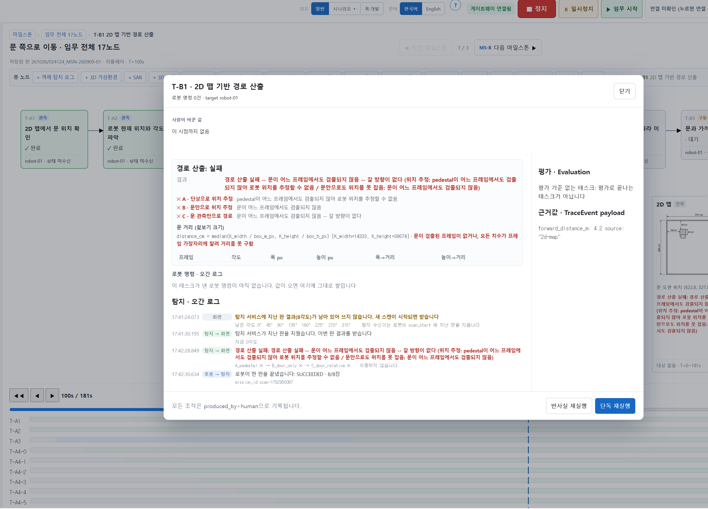
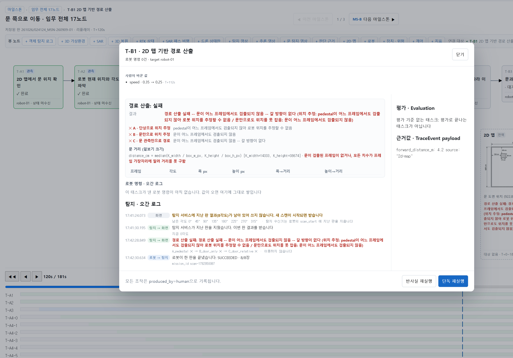
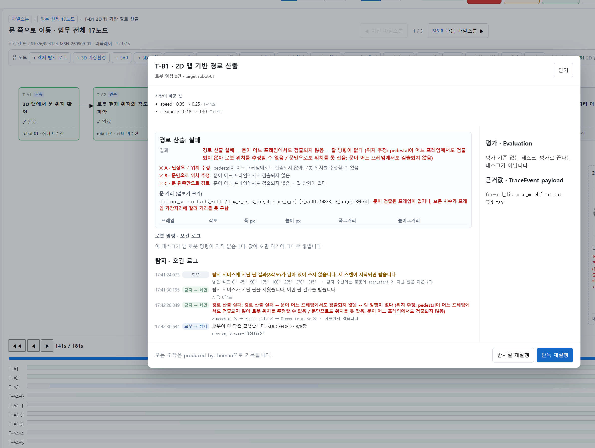
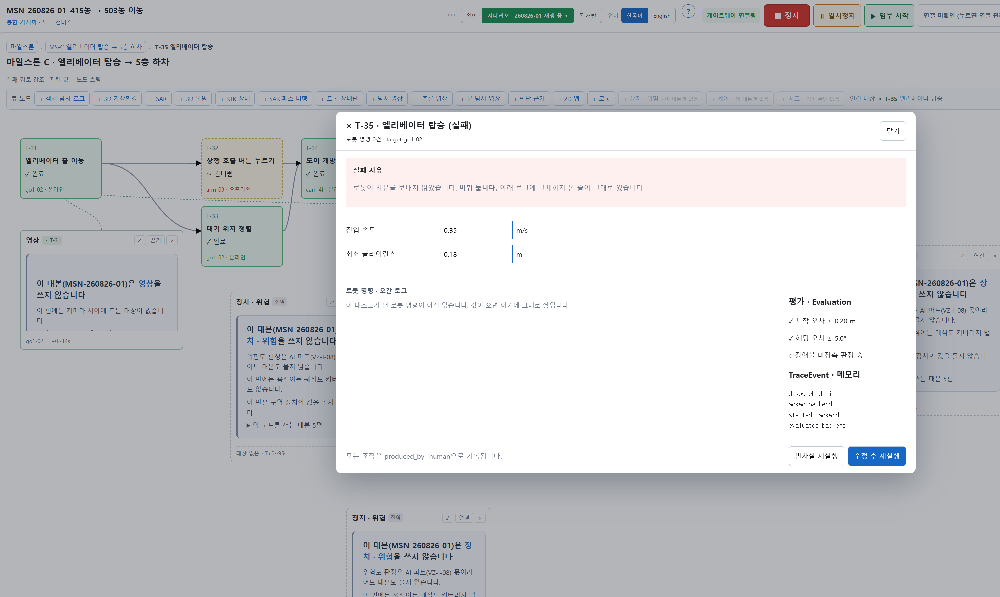

# 작업 보고: 사람이 바꾼 값을 되감아 볼 수 있게 한다

**날짜**: 2026-10-26
**지시**: `documents/작업프롬프트/작업프롬프트_조정되감기_261026.md`
**선행**: `작업보고/2026-10-26_adjusted판.md` 3절(원인 둘) · 액션 층 시각 2부 손보기 `167bf7e`
**판**: `mission-history/261026/024124_MSN-260909-01` — 로봇 안 씀
**상태**: 고침 · 검사 신설 끝(전종 **121 초록**). **사진 네 장 들어옴 — 3절 표대로 전부 맞다**(사람이 눈으로 확인). 작업 중 **이 판의 기록 열을 제가 한 번 지웠고 되살렸다**(5절 — 시점 프레임은 못 되살림)

> 한 줄 요약 — 입력칸과 목록을 갈랐다(지시서 2절 후보 그대로). 입력칸은 **라이브 실패 칸에만**, 「사람이 바꾼 값」 목록은
> **되감기에서도** 뜨고 슬라이더를 따른다. `167bf7e` 의 막음(되감기 중 노드를 열어도 화면을 안 바꾼다)은 한 글자도 안 건드렸다 —
> 목록이 실패 화면에 기대지 않게 폼 밖에 한 벌 더 둔 것이다. 실제로 그려 보면 024124 의 두 사건이 100초 0줄 · 120초 한 줄 ·
> 141초 두 줄로 나오고, 되감기 입력칸 0 · 라이브 입력칸 2 다.

---

## 0절 — 기준선

| 확인 | 결과 |
|---|---|
| 검사 | `verify:*` **120종** · 착수 전 전종 **120 초록** · typecheck 0. 이번 판에서는 `verify:fake-device` 도 초록이었다(흔들리는 검사 — 손대지 않음) |
| 작업 트리 | 생성기 3단계(10/23) 변경이 커밋 전이다. 겹치는 파일은 `viz-debugger/package.json` 하나(검사 한 줄 추가) |
| 판 | `024124` — 기록 열 101건 · `adjusted` 2건(112.395초 speed · 140.858초 clearance) |

---

## 1절 — `167bf7e` 가 무엇을 막았나 · 어떻게 지켰나

**막은 것** — 되감기(`replay`) 화면에서 노드를 누르면 `openTask` 가 화면을 `'detail'`(실패면 `'failure'`)로 바꿨다. 그러면 `GraphScreen` 의 `replay` 가 거짓이 되고 `override` 가 비워져, 슬라이더를 옮긴 **바로 그 순간에 명령 표가 판의 끝으로 접혔다.** `167bf7e` 는 「다시보기 중이면 노드를 열어도 화면을 안 바꾼다」로 막았고, `verify:action-modal-rewind` ②-b 와 그 대조군(「노드를 열 때 화면을 바꾸는 사본」)이 지킨다.

**이유** — 되감기 상태(`override`)가 화면 종류에 묶여 있다. 화면을 바꾸면 되감기가 풀린다. 그리고 실패 칸(다시 내기 · 값 바꾸기)은 지난 판에서 쓸 수 없다.

**지킨 법** — 화면 전환을 건드리지 않았다. `openTask` · `GraphScreen` · `override` 는 그대로다. 대신 `ActionModal` 이 **되감기 중인지를 따로 받는다**(`rewind={screen === 'replay'}`). 되감기에서는 `failure` 가 계속 거짓이고, 그 상태에서 목록만 그린다. `verify:action-modal-rewind` 는 고친 뒤에도 원본 · 대조군 4건 모두 그대로 초록이다(②-b 포함).

---

## 2절 — 입력칸과 목록을 어떻게 갈랐나

`views/ActionModal.tsx`

| | 라이브 실패 칸 | 되감기 |
|---|---|---|
| 입력칸(진입 속도 · 최소 클리어런스) | 뜬다 — `editable = failure && !rewind && 명령 0건` | **안 뜬다** |
| 「사람이 바꾼 값」 목록 | 폼 안에 그대로 | **폼 밖에 한 벌** — 그 태스크에 조정이 한 번이라도 있었으면(`everAdjusted`), 슬라이더 지점까지만 |
| 목록이 읽는 시각 | 라이브 머리 | `second`(슬라이더) — 따라가는 중이면 머리 |

- **원인 가(단순 누락)** — `planAdjustments(displayMission().headSec, …)` → `planAdjustments(second ?? displayMission().headSec, …)`. 명령 표를 `actionsAt(second)` 로 옮긴 2부와 같은 꼴이다.
- **원인 나(일부러 막은 것)** — 위 1절.
- **아직 없는 지점** — 되감기 목록은 0줄일 때도 자리를 세우고 「이 시점까지 없음」을 적는다(`act.adjustedNone` 한·영 한 줄씩). 0줄일 때 통째로 사라지면 100초 사진이 「목록이 비었다」인지 「목록이 안 그려졌다」인지 가를 수 없다. 라이브 실패 칸은 예전처럼 0줄이면 안 그린다.
- **조정이 없는 태스크** — 되감기에서도 목록을 안 그린다. 모든 노드에 빈 「사람이 바꾼 값」이 붙으면 소음이다.

### 후보와 다르게 한 곳 — 둘

1. **되감기 여부를 `second` 로 판정하지 않고 `rewind` 를 새로 넘겼다.** `second` 는 되감은 값이 있을 때만 차고(`viewSecond`), 다시보기를 막 열어 슬라이더를 아직 안 건드린 상태에서는 비어 있다. `second` 로 가르면 그 상태에서 목록이 안 뜬다. 「라이브 입력칸까지 감춘 사본」 대조군이 바로 그 실수의 모양이다(4절).
2. **라이브 실패 칸의 목록은 폼 안에 그대로 두었다.** 전부 폼 밖으로 옮기면 라이브 화면의 모양도 바뀐다. 라이브는 한 줄도 안 바꾸고, 되감기용으로 한 벌만 더 그렸다.

---

## 3절 — 사진 세 장 · 라이브 입력칸 (사람이 확인 — 들어옴)

### 결과 — 네 장 모두 표대로

| 100s — 「이 시점까지 없음」 | 120s — speed 한 줄 |
|---|---|
|  |  |
| **141s — speed · clearance 두 줄** | **라이브 실패 칸 — 입력칸 둘** |
|  |  |

- 1~3: 머리줄 「저장된 판 261026/024124_MSN-260909-01 · 리플레이 · T+100s / 120s / 141s」 · 슬라이더 `100s / 181s` 등 · 창 제목 「T-B1 · 2D 맵 기반 경로 산출」(× 없음) · **입력칸 없음** · 「로봇 명령 0건」. 120s 는 `speed · 0.35 → 0.25 · T+112s` 한 줄, 141s 는 그 아래 `clearance · 0.18 → 0.30 · T+141s` 가 붙는다
- 4: `MSN-260826-01` 라이브 재생(「시나리오 · 260826-01 재생 중」) · 실패 칸 「× T-35 · 엘리베이터 탑승 (실패)」 · 로봇 명령 0건 · **진입 속도 0.35 m/s · 최소 클리어런스 0.18 m 입력칸 둘**. 아래 순서는 T-33 을 적었는데 그 재생에서는 T-33 이 완료로 떠서 **T-35(93초 실패)** 로 찍었다 — 조건(실패 · 명령 0건)이 같다
- **덤으로 보인 것(범위 밖 · 고치지 않음)** — 되감기 창(1~3)에도 하단 「반사실 재실행 · 단독 재실행」 버튼이 그대로 있다. 누르면 지난 판을 보는 중에 게이트웨이로 명령이 나간다(`issueCommand`). 입력칸을 감춘 것과 같은 이유(「지금 누르면 그때가 바뀌나」)로 되감기에서 감출지 정할 일이다

### 찍은 순서 (기록용)

#### 다시보기 세 장

0. **브라우저를 새로 고침(F5)한다** — 5절 때문이다. 화면이 그 판을 아직 붙들고 있을 수 있다.
1. 이력 → `261026` · `024124_MSN-260909-01` → 「다시보기」. 화면이 리플레이 · 임무 전체로 바뀐다.
2. 슬라이더 옆 숫자가 `{지점}s / 181s` 다(판 머리 180.39초). 끌어서 가까이 간 뒤 ◀ ▶(1초씩)로 맞춘다.
3. 지점마다: 슬라이더를 맞춘다 → **T-B1(2D 맵 기반 경로 산출) 노드를 누른다** → 창을 찍는다 → 「닫기」(닫아도 되감기는 안 풀린다). 다음 지점에서 다시 연다.

| 슬라이더 | 창에 보여야 할 것 | 사진 |
|---|---|---|
| **100s** | 「사람이 바꾼 값 · 이 시점까지 없음」 · 입력칸 없음 | `assets/2026-10-26_조정되감기/1-100s.png` |
| **120s** | `speed · 0.35 → 0.25 · T+112s` 한 줄 · 입력칸 없음 | `2-120s.png` |
| **141s** 이후(끝 181s 도 같다) | 위 줄 + `clearance · 0.18 → 0.30 · T+141s` 두 줄 · 입력칸 없음 | `3-141s.png` |

창 제목에 × · 「실패」가 안 붙는 것이 맞다 — 되감기에서는 실패 칸이 아니라 보기 칸이다(1절).

#### 라이브 입력칸 — 로봇 없이

구판 대본 `MSN-260826-01`(「415호에서 503호로 이동해줘」)에는 실패가 들어 있다 — **31초 T-33(대기 위치 정렬)** · 93초 T-35, 둘 다 명령 0건이다. 로봇이 안 붙어 있으면 화면이 이 대본을 혼자 재생한다.
1. 그 대본을 승인 · 재생한다 → 31초 넘어 T-33 이 × 가 되면 **라이브 그래프에서 T-33 노드를 누른다**
2. 실패 칸에 「진입 속도 0.35 m/s · 최소 클리어런스 0.18 m」 **입력칸 둘이 뜨는지** 본다 → `4-live.png`
3. 값은 안 바꿔도 된다(바꾸면 그 시험 판에 `adjusted` 가 남는다 — 해롭지 않다)

이 판은 이력 폴더가 하나 생긴다(시험 판).

---

## 4절 — 신설 검사 `verify:adjust-rewind`

**글자가 아니라 그린 결과를 본다.** `ActionModal.tsx` 는 TSX 라 노드가 바로 못 읽으므로 탐침(`scripts/lib/adjustRewindProbe.mjs`)이 esbuild 로 그 화면과 저장소를 한 묶음으로 묶고(같은 저장소 인스턴스여야 한다), 024124 의 두 사건을 실제 기록 길(`recordAdjusted`)로 다시 적은 뒤 `renderToString` 으로 그린다.

| 보는 것 | 원본 |
|---|---|
| ① 목록이 `second` 를 받는다 — 100초 0줄 · 120초 speed 한 줄 · 141초 두 줄 | ✅ |
| ② 되감기에서 목록이 그려진다 — 세 지점 · 따라가는 중 | ✅ |
| ③ 되감기에서 입력칸이 안 그려진다 — 세 지점 · 실패 칸이 어떻게든 열려도 | ✅ 0개 |
| ④ 라이브 실패 칸 — 입력칸 둘 · 목록 두 줄 | ✅ |
| 배선 — `MissionDebugger` 가 `rewind={screen === 'replay'}` 를 넘긴다 | ✅ |

대조군 — `src/` 통째 복사 · LF 정규화 원본(`readSource`)에서 한 줄(`mutantTree`). **다섯 다 잡혔다.**

| 대조군 | 잡은 줄 |
|---|---|
| `displayMission().headSec` 로 되돌린 사본 | ① 100초에 2줄 |
| 되감기에서 목록을 안 그리는 사본 | ① · ② 목록 없음 |
| 되감기에 입력칸을 띄우는 사본 | ③ 되감기(실패 칸)에 입력칸 2개 |
| 라이브 입력칸까지 감춘 사본(되감기를 `second` 로 판정) | ④ 라이브 입력칸 0개 |
| 되감기 여부를 안 넘기는 사본 *(지시서 4절 밖 · 하나 더)* | 배선 |

**고치기 전 원본에 탐침을 돌렸을 때**: 되감기 세 지점 모두 목록 없음 · 실패 칸을 억지로 열면 120초에도 두 줄(슬라이더 무시) — 3절 원인 둘이 그대로 잡혔다.

---

## 5절 — 작업 중 사고: 024124 의 기록 열을 지웠다 · 되살렸다

**무엇이** — 03:29:52(KST) 제가 `ActionModal.tsx` · `main.tsx` · `ko.ts` · `en.ts` 를 고친 순간, 떠 있던 개발 서버(vite)가 브라우저에 핫 리로드를 밀었다. 브라우저는 그때까지 024124 판을 라이브로 열어 둔 채였다. 모듈 일부가 새로 올라오며 **기록 열과 시점 프레임 저장소가 비었고, 기록기는 같은 판을 붙든 채 그 빈 상태를 판 폴더에 덮어썼다** — `progress.json` 의 `trace` 0건 · `viewpointFrames` 0건 · `headSec` 2907.461(판 머리가 아니라 그때까지 흐른 시계). 이력 다시보기로 열면 사건이 하나도 없는 판이 됐을 것이다.

**되살린 것** — 02:44 에 뽑아 둔 `trace.mcap`(101건)에서 기록 열을 되살렸다. 변환기는 사건을 통째로 싣고(`dict(ev)`) `layer` · `seqBand` · `payloadText` 셋만 덧붙이므로 그 셋을 걷으면 원래 사건이다. 되살린 열로 MCAP 을 다시 뽑아 **101건이 바이트까지 같은 것**을 확인했다. `headSec` · `updatedAtIso` 는 덮이기 전에 읽어 둔 180.39 · `17:44:25.662Z` 로 되돌렸다. `mission.json` 은 그 두 칸 말고 덮인 본과 같다(서식 포함).

**못 되살린 것** — `viewpointFrames`(시점 프레임). MCAP 에 없다. 촬영 각도 칸을 되감을 때 쓰는 값이라 이번 사진 세 장(T-B1 창)에는 영향이 없다. 촬영 사진(`images/` 17장) · `robotFrames` 8 · `detectLog` 42 는 기록기 쪽이 들고 있어 그대로다.

**덮인 본** — scratchpad 에 그대로 둠(`024124-progress-wiped.json` · `024124-mission-wiped.json` · `024124-trace-backup.mcap` · 복원 스크립트 `restore_024124.py`).

**드러난 결함(고치지 않음 — 범위 밖)** — 기록기가 **비어 있지 않던 판의 기록 열을 빈 열로 덮어쓴다.** 핫 리로드는 개발 중에만 일어나지만, 저장소가 다른 이유로 비워져도 같은 일이 난다. 「쓴 적 있는 판에 빈 열은 쓰지 않는다」 같은 막음이 있어야 한다. 그리고 **개발 서버를 띄운 채 판을 열어 둔 상태에서 `src` 를 고치면 안 된다** — 고치기 전에 브라우저를 새로 고치거나 닫는다.

---

## 6절 — 깨진 검사 · 고친 방법

**없다.** 고친 뒤 전종 **121 초록**(120 + 신설 1) · typecheck 0.

`verify:action-modal-rewind` 는 깨질 것으로 봤으나 안 깨졌다. 그 검사의 ③은 `actionsAt(…)` 호출만 세고 `planAdjustments` 는 안 본다. ②는 `<ActionModal` 요소에 `second={viewSecond ?? undefined}` 가 있는지만 보는데 `rewind=` 는 그 앞에 들어갔다. 조건을 빼거나 옮길 일이 없었다. 그 검사가 못 보던 `planAdjustments` 의 시각은 이제 `verify:adjust-rewind` ①이 본다.

---

## 7절 — 지시서와 다르게 한 곳

| 곳 | 이유 |
|---|---|
| 되감기 여부를 `second` 가 아닌 `rewind` 로 넘김 | 2절 — 따라가는 중이면 `second` 가 비어 목록이 안 뜬다 |
| 라이브 목록은 폼 안에 두고 되감기용을 한 벌 더 | 2절 — 라이브 화면을 안 바꾸려고 |
| 되감기 목록이 0줄이어도 「이 시점까지 없음」으로 자리를 세움 · 한·영 사전 한 줄씩 | 100초 사진이 「비었다」와 「안 그려졌다」를 가르게 |
| 대조군 하나 더(되감기 여부를 안 넘기는 사본) | 배선이 빠지면 탐침은 초록인데 앱에서는 안 뜬다 |
| 검사가 글자 대신 그린 결과를 봄(esbuild 묶음) | ②·③·④는 「그려지는가」라 글자로는 대조군을 못 잡는다 |
| 024124 판 파일을 고쳤다(복원) | 5절 — 제가 지운 것을 되돌렸다. 「기록 쪽은 손대지 않는다」는 코드 범위이고, 이것은 판 데이터를 원래대로 돌린 것이다 |

---

## 8절 — 끝나면(지시서 7절) — **사진 들어옴**

사진 세 장(+ 라이브 한 장)이 들어와 **기여 1 의 예외가 닫혔다.** 사람이 바꾼 값도 재실행 없이 슬라이더로 되감긴다.
- §6-2 에서 「사람이 바꾼 값을 되감아 볼 수 있는지」를 뺀다
- §4-5 에 `2-120s.png` · `3-141s.png` 두 장을 붙일 수 있다(지금까지는 기록 표만)
- Foxglove Q6 의 우리 쪽 조작 수를 이 순서로 셀 수 있다 — 이력에서 「다시보기」 → 슬라이더 맞춤 → T-B1 노드 한 번(지점마다 닫고 다시 열기)

논문에 쓸 때 단서 둘: 이 판은 한 번 지워졌다 되살린 판이다(5절 · 기록 열은 바이트까지 같음, 시점 프레임 없음). 그리고 바꾼 값은 T-B1 이 쓰지 않는 파라미터를 화면 초깃값에서 바꾼 것이다(`2026-10-26_adjusted판.md` 4절).
