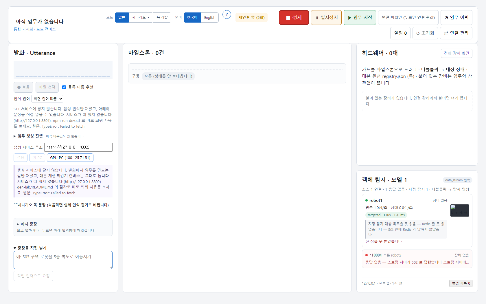
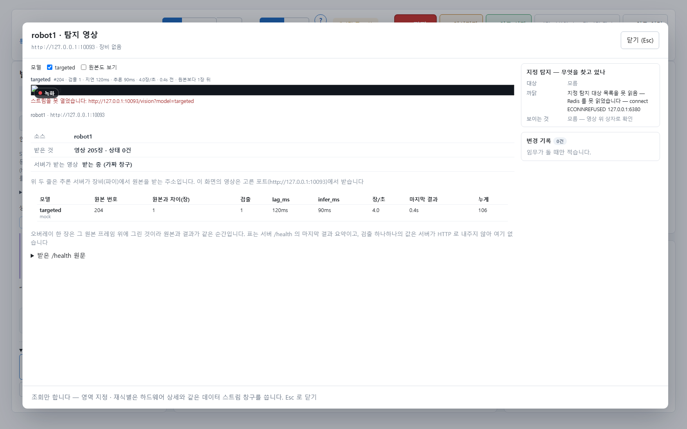

# 작업 보고: 「기능」 판 자리를 객체 탐지 상태판으로 — data_stream 탐지 모델을 조회만 한다

**날짜**: 2026-11-24
**커밋**: `393c17c`(계획 · 추론 스트림 IP) · `c75a523`(상태판 구현) · 이 보고서와 같은 커밋(10004 → `ep-001`) — 브랜치 `khw_VZ`
**관련**: 개발 계획 [`../작업프롬프트/작업프롬프트_탐지모델상태판_개발계획_261124.md`](../작업프롬프트/작업프롬프트_탐지모델상태판_개발계획_261124.md) ·
시안 그림 [`../작업프롬프트/탐지모델상태판_시안_261124/`](../작업프롬프트/탐지모델상태판_시안_261124/) ·
data_stream 기준 `JNY03/physical_demo` `data_stream` 브랜치 `a1e43f8` → `b73fc65`
**상태**: **가시화 쪽은 끝났다. 실물 확인이 남았다.** data_stream 이 꺼져 있어(작업 끝 무렵에는 노트북이 테일넷에서도 사라졌다)
실제 탐지 영상 · 대상 목록은 아직 못 봤다. 화면은 실서버 응답 없음 · 가짜 창구 두 경우로 확인했다.

> 한 줄 요약 — 마일스톤 화면 오른쪽 아래의 「기능」 판을 화면에서 빼고(코드는 둠), 그 자리에 data_stream 이 **지금 돌리는 탐지 모델**을
> 포트(소스)마다 보여 주는 판을 세웠다. 카드를 더블클릭하면 그 포트의 탐지 영상 창이 뜨고 하드웨어 상세에서 하던 일이 그대로 된다.
> 지정 클래스 탐지(`targeted`)가 무엇을 찾는지와, 임무 판 동안 모델 · 대상이 바뀐 기록도 본다. data_stream 코드는 고치지 않았다.

---

## 1절 — 무엇을 정했나 (사용자 결정)

| 항목 | 결정 |
|---|---|
| 자리 | 하드웨어 카드 아래 「기능」 판 자리. 「기능」 판은 **보이는 것만 삭제, 코드는 유지**(`src/capability/`) |
| 범위 | 조회만. 연결은 지금도 되므로 **data_stream 쪽 코드는 수정하지 않는다** |
| 하드웨어 없이 | 탐지 모델만 붙어 있어도 조회 |
| 더블클릭 | 그 항목의 이미지 스트림 — 하드웨어 카드 상세에서 객체 탐지 영상에 하던 작업 전부 |
| 조회 주기 | 판은 2초, 상세가 열린 포트만 1초 |
| 지정 탐지 대상 | Redis 로 읽는다 (Redis 6380 은 테일넷 쪽으로 열려 있다 — 사용자 확인) |
| 변경 기록 | **임무 판이 돌 때만** 남긴다 |
| 추론 스트림 IP | 연결 관리 「스트림 서버 (테일넷)」 선택지를 `100.102.8.102` → **`100.125.104.23`**(data_stream 노트북 WSL) |
| 10004 이름 | data_stream 에서 `robot2` → **`ep-001`**(pi1 이 Go1 에서 RoboMaster EP 로) — 반영 |

순서: 계획서와 시안 그림 셋을 먼저 만들어 보이고(구현 없이), 결정을 받은 뒤 구현했다.

## 2절 — 읽는 창구 (data_stream 무수정)

| 무엇 | 창구 | 비고 |
|---|---|---|
| 소스 · 받은 장 수 · 연결 문장 · 모델별 요약 | `GET <포트>/health` | 원래 쓰던 것. 개발 서버 중계(CORS 없음) |
| 스캔 판이 돌고 있나 | `/health` 의 `vision.targeted.scan.busy_scan_id` | 새로 읽는다 |
| 오버레이 · 원본 영상, 근거 카드, 영역, 재식별 | `/vision` · `/stream` · `/vision/frame` · `/control/roi` · `/control/reid` | 원래 있던 부품 그대로 |
| **지정 대상 · 프로필 판 · 마지막 장 라벨** | Redis `vision_stream:<소스>:targeted` 마지막 한 건 | **새 창구** — HTTP 는 이 칸들을 걸러 내므로(`view_result`) Redis 에서 직접 |

새 창구는 개발 서버 미들웨어 한 경로다.

```
GET /vision-stream/latest?redis=redis://<host>:6380&source=<소스>&model=<모델>
  → XREVRANGE vision_stream:<소스>:<모델> + - COUNT 1  (이 명령 하나만 보낸다)
  → { id, run, n, targets, provisional, distance, profile{label, version, scanId}, labels{라벨: 개수} }
```

`redis` 는 경로 · 계정 없는 `redis://host:port` 만, 소스 · 모델은 이름표 모양만 받는다. 그림 · 상자는 요약에서 뺀다.
Redis 주소는 연결 관리 「객체 탐지 추론 스트림」에 새로 둔 **Redis 칸**이고, 비우면 서버 IP 칸의 호스트 `:6380` 이다.

## 3절 — 만든 것

### 화면

| 파일 | 하는 일 |
|---|---|
| `src/detect/status/views/DetectModelPanel.tsx` | 판. 머리 「객체 탐지 · 모델 N」 + 끌 수 없는 「data_stream 실측」 배지, 포트마다 카드, 발에 주소 · 마지막 읽은 때 · 「변경 기록 N」 |
| `src/detect/status/views/DetectStreamOverlay.tsx` | 더블클릭 상세 창. 왼쪽은 `VisionCam`(포트 고정), 오른쪽은 지정 탐지 칸과 그 포트의 변경 기록 |
| `src/detect/status/views/DetectStatusParts.tsx` | 지정 탐지 한 줄/칸 · 변경 기록 목록 (판과 상세가 같이 씀) |
| `src/main.tsx` | `<CapabilityPanel />` 자리에 판. 상세 창은 하드웨어 상세 · 전체 장치 확인과 **동시에 하나만** 열림 |

**카드 한 장 = 연결 관리의 포트 줄 하나.** 장비 목록에서 나오지 않으므로 하드웨어가 0대여도 뜬다. 상태 점은 다섯이다:
초록(모델 결과 들어옴) · 회색(원본만) · 노랑(원본 끊김) · 회색(처음 묻는 중) · 빨강(`/health` 무응답).
서버가 이름을 밝히기 전에는 `:10001 보통 cam360` 처럼 포트와 표에 적힌 소스를 흐리게 적는다(전체 주소를 제목에 두면 카드가 서로 안 갈린다).
모델 수는 **결과가 30초 안에 온 (포트, 모델) 쌍의 수**다 — 화면은 비전 프로세스가 몇 개인지 모른다.

**상세 창**은 하드웨어 상세의 탐지 칸과 같은 부품(`VisionCam` → `VisionCell`)을 쓰고 `fixedBase` 만 더했다. 그래서 녹화 · 잘라내기,
근거 카드, 영역 지정, 재식별, 원본 나란히, 요약 표가 그대로 된다. 모델 칩을 더블클릭하면 그 모델 하나로 열린다.
고름 저장 키는 `ds:<포트>` — 하드웨어 상세(`hw:<장비>`)와 나눠, 여기서 바꾼 고름이 장비 상세에 번지지 않는다.





(가짜 창구에는 `/vision` 이 없어 영상 칸은 「스트림을 못 열었습니다」이고, Redis 가 없어 대상은 「못 읽음 — 사유」다. 둘 다 그 경우의 맞는 표시다.)

### 지정 탐지 — 출처 넷

| 출처 | 언제 | 적는 것 |
|---|---|---|
| 이 화면의 스캔 판 | `scanStore` 의 판이 그 포트에서 돌고 있다 | 대상 · 임무 · 각도 n/8 · 프로필 판 |
| 남의 스캔 판 | `busy_scan_id` 가 있는데 이 화면의 판이 아니다 | 판 번호 · 대상(Redis 결과가 그 판의 것일 때만) |
| 런처 설정 | Redis 마지막 결과에 `targets` 가 있다 | 대상 · profile v · 하한 측정 전 대상 |
| 못 읽음 | 위가 다 아니다 | 사유 (Redis 오류 · 아직 결과 없음) |

「보이는 것」(마지막 장 라벨 수)은 출처와 따로 늘 적는다 — 찾는 것과 보이는 것은 다른 말이다.

### 변경 기록

data_stream 은 바뀐 기록을 남기지 않으므로 **조회마다 앞 값과 비교해 사건을 만든다**(`src/detect/status/history.ts` 의 순수 함수
`diffDetectSnapshot`). 사건: 모델 + · 모델 −(30초 넘게 결과 없음) · 다시 시작(run 바뀜 · 누계 줄어듦) · 대상 바뀜 · 프로필 판 ·
스캔 판 시작/끝 · 응답 없음 · 다시 연결(끊긴 길이).

- **임무 판이 기록되는 동안만**(`recorderStatus().state === 'recording'`) 쌓는다. 새 판 폴더면 「기록 시작 — 지금 모델 · 대상」부터 적는다.
- 판 기록 `progress.json` 에 `detectModels` 로 실리고, 임무 이력에서 그 판을 열면 되살아난다(`recorder.ts` · `loadRecord.ts`).
- 끊긴 동안은 모델 · 대상을 앞 값 그대로 들고 간다 — 안 그러면 끊김 한 번에 「모델 −」, 다시 붙으면 「모델 +」 가 줄줄이 찍힌다.
- 대상을 못 읽은 순간(Redis 오류)도 앞 값을 든다 — 읽기 실패를 「대상 바뀜」으로 적지 않는다.

### 저장 · 조회

| 파일 | 하는 일 |
|---|---|
| `src/vision/visionClient.ts` | `/health` 파서 수정(5절) · Redis 주소(`visionRedisUrl`) · 창구 주소 |
| `src/vision/store.ts` | 느린 붙잡기(`holdAllVisionSources({ slow: true })`, 2초) · 원본 장/초 · 상태 건/초 |
| `src/detect/status/summary.ts` | 카드 줄 · 상태 점 · 순서 · 머리 숫자 · 장비 묶음 거꾸로 읽기 |
| `src/detect/status/latestStore.ts` | targeted 가 살아 있는 포트만 2초마다 Redis 요약 |
| `src/detect/status/targets.ts` | 출처 넷 고르기 |
| `scripts/vision-redis-latest.mjs` | RESP 명령 · 답 뜯기 · 한 건 요약 · 읽기 한 번 |
| `scripts/vision-stream-relay.mjs` | `latest` 경로 · 주소 검사 |
| `src/shared/connections.ts` | 연결 관리 Redis 칸 |

## 4절 — D0 실측

| 본 것 | 결과 |
|---|---|
| 호스트 `100.125.104.23` | ping 7 ms (작업 끝 무렵에는 100% 손실 — 노트북이 테일넷에서 빠짐) |
| Redis 6380 (테일넷) | `PONG`. 키 0개 — 스트림 서버가 꺼져 있었고 Redis 는 `--save ""` 라 다시 켜면 빈다 |
| 스트림 서버 포트 10001~10012 | 모두 닫힘 |
| `/health` · 결과 한 건 모양 | 실물 대신 data_stream 코드(`a1e43f8`)로 확인 |

실물이 없어서 코드로 확인한 것 셋:

1. 스캔 창구가 `/health` 의 `vision.targeted` 안에 `scan` 을 끼워 넣는다 — targeted 가 안 돌아도 그렇다(5절).
2. Redis 한 건에 오버레이 JPEG(품질 90)가 같이 실려 필드만 골라 받을 수 없고, 보관은 300건이다. 그래서 계획의 D7(Redis 로 지난 기록 거슬러 채우기)은 **뺐다** — 300장을 내려받아야 하고, 「임무 판일 때만 기록」 결정으로 필요도 없어졌다.
3. 결과의 `profile.scan` 은 사전이 아니라 `scan_id` 문자열이다 — 처음 짠 요약이 사전으로 읽고 있어 고쳤다.

## 5절 — 도중에 잡은 문제

| 문제 | 원인 · 조치 |
|---|---|
| 모든 포트에 결과 한 번 없는 「targeted」 모델이 읽혔다 (기존 화면에도 있던 문제) | 스캔 창구가 `vision.targeted.scan` 을 끼워 넣어서. 파서가 요약 칸(`results` · `age_s` 등)이 하나도 없는 항목은 모델로 세지 않고, 판 번호는 `scan.busyScanId` 로 따로 든다 |
| 가짜 창구(`scan:mock`)의 `/health` 가 `vision.scan` 에 판을 두었다 | 실물과 다른 자리. 실물 모양(`vision.targeted.scan` · 요약 칸 · 포트)으로 맞췄다 |
| `verify:server-link` 가 `<CapabilityPanel />` 까지 잘라 「하드웨어 판 안에 서버 칸이 없다」를 봤다 | 판을 빼자 자르는 끝이 사라져(-1) 검사가 「나머지 전부」를 보며 통과하고 있었다. 끝을 `<DetectModelPanel` 로 |
| 응답 없는 포트 카드가 전체 주소를 제목으로 · 오류 문장이 두세 줄 | 이름을 `:포트 · 보통 <소스>` 로, 오류는 한 줄 말줄임(전문은 마우스) |
| 오류를 한 줄로 막자 판에 가로 스크롤 | 카드에 `min-width:0 · overflow:hidden` |
| 상세 창 본문이 창 가장자리에 붙음 | 본문 여백 |

## 6절 — 검사

- **`verify:detect-status`**(새로 만듦) — `/health` 뜯기(빈 targeted · 판 번호) · 카드 줄(상태 점 다섯 · 순서 · 머리 숫자 · 장비 0대) ·
  Redis 창구 경로 · RESP 뜯기와 한 건 요약(그림이 섞인 답, 두 조각으로 온 답, 빈 스트림) · 지정 탐지 출처 넷 ·
  변경 기록 비교 열 가지 · 임무 판일 때만. 대조군 5. **돌연변이 둘**(파서 거르기 끄기 · 끊긴 동안 모델 지우기)로 검사가 무는 것을 확인했다.
- 그대로 통과: `verify:vision-stream` · `scan-detect` · `scan-detect-link` · `scan-record` · `server-link` · `connection-panel` · `no-tabs` ·
  `capability-source` · `lang-switch` · `i18n-scope-leak` · `i18n-no-frozen` · `i18n-data` · `server-status`. 타입 검사 · 빌드 통과.
- 화면: 개발 서버를 띄워 Chrome DevTools 로 찍었다 — 하드웨어 0대 · 실서버 응답 없음 · 가짜 창구(robot1 targeted) → 카드 더블클릭 → 상세 창.

## 7절 — 10004 → `ep-001` (이 보고서와 같은 커밋)

data_stream `b73fc65`(2026-11-24): pi1 이 Go1(robot2)에서 RoboMaster EP 로 바뀌어 10004 의 소스 이름이 `ep-001` 이 됐다(포트는 그대로,
`robot2` 는 서버가 옛 이름으로 받아 준다). 스캔 창구의 장치 목록에서는 `go1-002` 가 빠졌다.

- `src/vision/presets.ts` — 포트 표와 기본 포트 줄의 이름을 `ep-001` 로.
- 문구 — 포트 선택지 `preset.vision.ep-001`(「ep-001 (10004 · RoboMaster EP)」, 옛 `preset.vision.robot2` 는 지움) · 연결 관리 설명의 포트 목록(한 · 영).
- 주석 · 검사 고정값(`vision-stream-relay.mjs` · `verify-vision-stream.mjs`).
- 연결 관리에는 포트 **번호**가 저장되므로 저장된 값은 그대로 맞는다. 가시화에는 `go1-002` 를 스캔 창구에 보내는 곳이 없어 따로 고칠 것이 없었다.

## 8절 — 쓰는 법과 한계

- **개발 서버를 다시 띄워야** Redis 창구가 선다(미들웨어를 고쳤다).
- Redis 창구는 개발 서버에만 있다 — 정적 빌드에서는 대상이 「못 읽음 — 창구 없음」으로 나온다. 판 · 상세 · 변경 기록은 된다.
- 변경 기록은 이 화면이 임무 판을 기록하는 동안만이다. 그 앞의 변화와, 다른 화면이 본 변화는 모른다.
- 모델 수는 포트마다 센 것이다. 같은 비전 프로세스가 두 포트를 돌리면 2 로 센다.
- 판이 늘 떠 있으므로 연결 관리의 포트 전부에 2초마다 `/health` 를 묻는다(한 건 1KB 안쪽). targeted 가 도는 포트는 2초마다 Redis 한 건(오버레이 JPEG 포함, 개발 서버가 받고 화면에는 작은 요약만)을 더 읽는다.
- 남은 것: data_stream 을 켠 상태로 실물 확인 — 모델 칩 · 런처 설정 대상 · 스캔 판(「임무 … 스캔 판 · 각도 n/8」) · 변경 기록이 쌓이는지.
