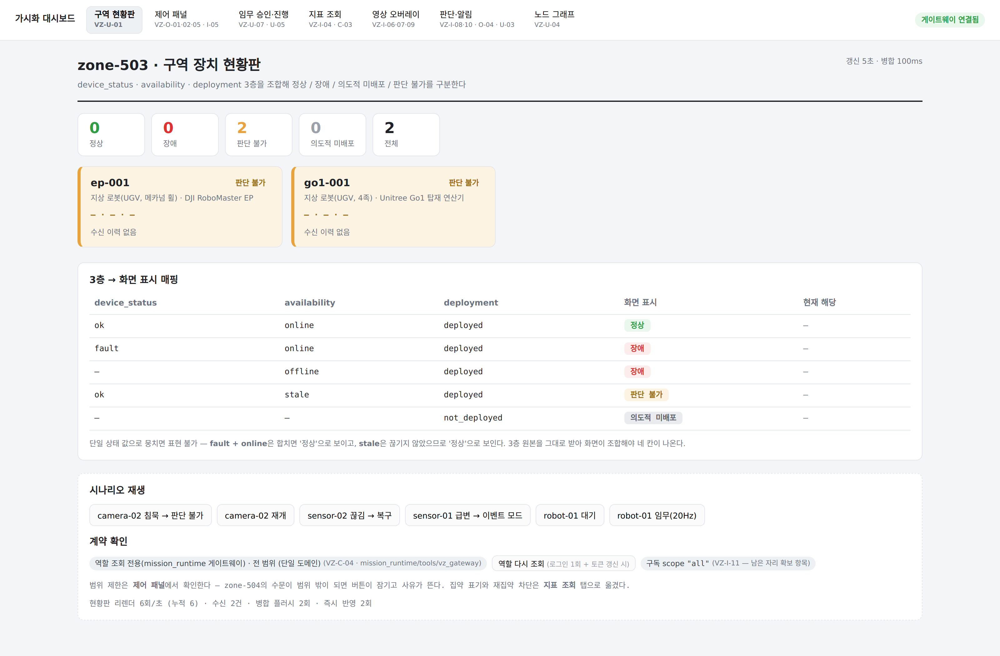

# 가시화 파트 인계 묶음

작성: 2026-11-03 · 대상: 가시화 파트 · 보내는 쪽: AI 파트(`mission_runtime`)

이 디렉터리 하나가 전부다. 문서·이미지·패치·계약이 모두 여기 있고, 바깥을 참조하지
않는다.

---

## 0. 먼저 볼 것 — 실제로 붙여 봤다

말로만 적지 않았다. `khw_VZ` 를 클론해 **그쪽 대시보드를 우리 데이터에 직접
연결**했고, 화면 코드는 한 줄도 고치지 않았다. 그쪽이 만들어 둔 교체 지점
(`VITE_GATEWAY_WS`)이 그대로 동작한다.



화면에 뜬 `zone-503` · `ep-001`(RoboMaster EP) · `go1-001`(Unitree Go1)은 **우리
선언에서 온 실제 장치**다. 둘 다 `판단 불가 · 수신 이력 없음` 인 것도 맞는 결과다 —
선언만 되어 있고 아직 공지한 적이 없으므로 `quality=unknown` 으로 나간다. 여기서
`정상` 으로 칠했다면 그것이 틀린 화면이다.

```bash
# 1) 우리 게이트웨이
cd mission_runtime && ../.venv/bin/python tools/vz_gateway/serve.py --port 8899

# 2) 그쪽 대시보드를 그쪽에 붙인다 (코드 수정 없음)
cd web-dashboard
VITE_GATEWAY_WS=ws://127.0.0.1:8899 VITE_GATEWAY_HTTP=http://127.0.0.1:8899 npm run dev
```

지금 나가는 채널은 `state` 와 `metrics` 둘이다. `metrics` 는 이 기계에서 **실제로 잰
값**이고(psutil·nvidia-smi), `risk_state` 와 `detections` 는 이 배치에 제공자가 없어
**발행하지 않는다** — 빈 채로 두는 것이 그럴듯한 숫자를 채우는 것보다 낫다.

---

## 1. 문서

| 파일 | 무엇 |
|---|---|
| **`visualisation-requests.md`** | 반영 요청 본문. 미반영 요구사항 26건, 그중 다섯은 예시 화면과 함께 |
| `contracts/view-contract.md` | 우리 조회 계약 전문 |

## 2. 이미지 (`images/`)

| 파일 | 무엇 |
|---|---|
| `01-identity-evidence.png` | 동일성 근거 분해 — 지금 ↔ 필요한 것 |
| `02-risk-evidence-sufficiency.png` | 위험도와 근거 충분도는 다른 축 |
| `03-capability-grounding.png` | 계획 검증의 capability 접지 |
| `04-rerun-attempt.png` | 재실행 회차 보존 |
| `05-measured-vs-unmeasured.png` | 미측정 ≠ 0 ≠ 미달 |
| `06-node-graph-evidence.png` | 근거 확인 노드가 열린 그래프 **(그쪽 UI 에서 실제로 돈다)** |
| `07-evidence-node.png` | 근거 확인 노드 — 수락 사례 |
| `08-evidence-undecided.png` | 근거 확인 노드 — 미결정 사례 |
| `09-integration-live.png` | **우리 게이트웨이에 붙인 실제 화면** |

## 3. 패치 (`patch/`)

`vz-evidence-node.patch` — 노드 그래프의 근거 노드를 눌렀을 때 **근거 확인 노드**가
한 칸 더 열리게 한다. `khw_VZ` 새 클론에 깨끗하게 적용되고 `tsc -b` 를 통과한다.

```bash
git apply vz-evidence-node.patch
mkdir -p web-dashboard/public/evidence && cp *.jpg web-dashboard/public/evidence/
npm run dev        # 노드 그래프 탭 → 근거 노드 클릭
```

바뀌는 파일은 셋뿐이다 — `EvidenceDetail.tsx`(신규) · `NodeGraphView.tsx` ·
`styles.css`. 숫자를 만드는 `sampleCase()` 한 함수만 우리 계약을 읽는 것으로 바꾸면
그대로 실물이 된다.

## 4. 계약 (`contracts/`)

- `schemas/view_*.schema.json` — 조회 계약 9종
- `schemas/*.schema.json` — AI 산출 계약 6종(`detection-result` · `risk-judgment` ·
  `ai-failure` · `status-snapshot` · `frame-reference` · `capability-status`)
- `viz/` — **그쪽 형식으로 만들어 둔** 컴포넌트 선언 5종 + 데이터소스 1종.
  파이프라인 편집기 카탈로그에 등재하면 화면 코드 변경 없이 우리 상태를 그릴 수 있다.

이 사본은 2026-11-03 스냅샷이고, 정본은 `mission_runtime/schemas/` 와
`mission_runtime/docs/view-contract.md` 다.
