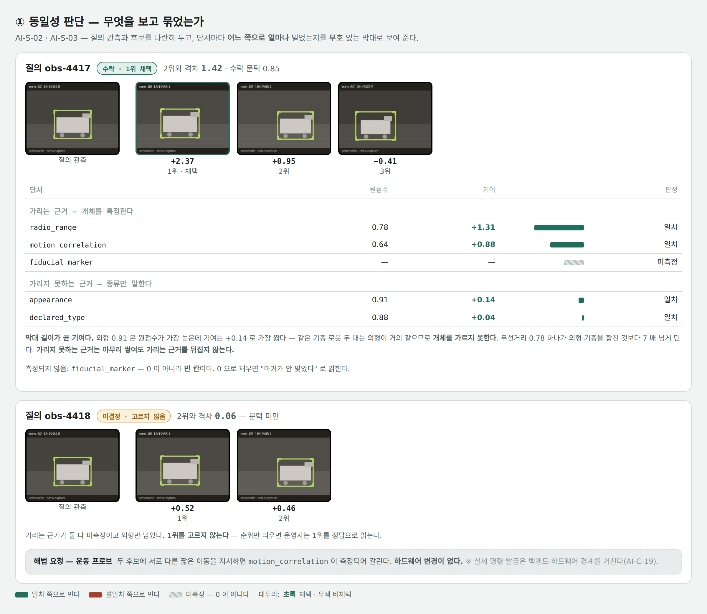
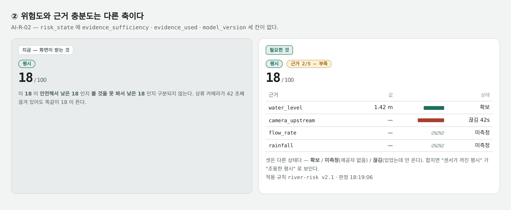
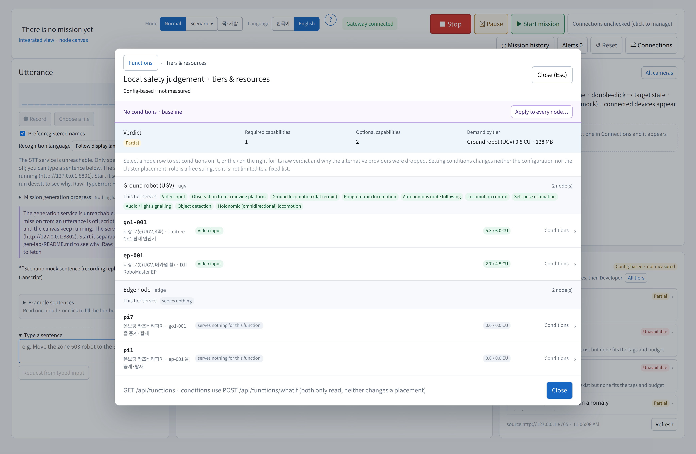

# 가시화 반영 요청 — AI 가 내는데 화면이 받지 않는 것

> **2026-11-04 정정.** 이 문서의 1판은 `web-dashboard`(옛 앱)를 보고 썼다. 최신은
> **`viz-debugger`**(게이트웨이 8790 · 화면 **5174** · STT 8801 · 생성 8802)이고, 다시
> 확인한 결과 **세 군데가 틀렸다.** 아래 §1 은 범위를 좁혔고, 옛 §3(capability 접지)은
> **철회**했다 — 최신 앱에는 기능 상태 패널이 있고 **우리 `tools/status_ui/serve.py` 를
> 이미 읽고 있다.** 틀린 채로 보내는 것보다 고쳐서 보내는 편이 낫다고 보아 그대로 적는다.

작성: 2026-11-03 · 대상: 가시화 파트
근거: `khw_VZ` 브랜치를 클론해 **실제로 띄워 보고**(최신 앱 `viz-debugger` — 게이트웨이 8790 ·
화면 5174 · 페이지 오류 0) 소스와 우리 계약을 맞춰 본 결과다.

이 문서는 **화면 설계를 요구하지 않는다.** 배치·색·상호작용은 그쪽 책임이고
(AI-C-19), 여기 적는 것은 *그 화면이 성립하려면 어떤 사실이 화면에 남아야 하는가*
뿐이다. 우리 쪽 데이터는 이미 나오고 있으므로 **새로 만들 것은 없고 받는 자리만
없다.**

`docs/integration-handover.md` §3 의 「가시화」 절을 이 문서가 채운다.

---

## 0. 한눈에

우리 요구사항 61건 중 **26건이 VZ 코드 어디에서도 참조되지 않는다.**

| 묶음 | ID | 빠진 것 |
|---|---|---|
| **2026-10-27 신규 6건 전부** | AI-B-12 · B-13 · O-05 · O-06 · L-09 · L-10 | 종합상황정보 Dashboard 대응분이 통째로 |
| **2026-11-02 신규 2건** | AI-B-14 · B-15 | 서브태스크 capability 접지 · 상황 기반 임무 추천 |
| 실행·자원 | AI-B-01~06 · B-09 | 실행 프로파일 · 패키징 · 실행 제어 · 노드 자원 · 생명주기 · 재구성 · 확장 검증 |
| 계약 기반 | AI-C-01 · C-06 · C-07 · C-18 · C-20 | 공통 데이터 규약 · 전송 경계 · 직렬화 · **Capability 선언** · **물리 명령 의미 계약** |
| 학습 후반 | AI-L-04 · L-05 · L-08 | 학습 실행 · 회귀 검증 · 계보 추적 |
| 인지·관측 | AI-S-07 · S-08 · O-03 | 업무 목적별 요구 근거 · 환경 사전정보 · 오류 재현 |

아래 표는 **"저장소 어디에서도 그 ID 를 참조하지 않는다"** 는 신호이고, 그것만으로
"기능이 없다"고 단정할 수 없다 — 실제로 1판에서 그렇게 단정했다가 셋을 철회했다
(§3·§4·§5). **소스를 직접 확인해 확실한 것은 §1 과 §2 둘이다.**

---

## 1. 동일성 판단 — **교차 소스 연계만** 스칼라 하나다 · AI-S-02 · AI-S-03

> **범위를 좁혔다(2026-11-04).** 1판은 "근거가 분해되지 않는다"고 적었는데 **틀렸다.**
> `src/detect/` 의 프레임별 근거는 **이미 분해돼 있다** — `feature_similarities`(특징별
> 점수) · `mandatory_gates`(필수 관문) · 거리 추정의 `formula` 와 `substituted` 까지
> `DetectViews.tsx` 가 그리고, `detectTrace.ts` 가 그것을 태스크 노드로 옮긴다.
> `final_score` 를 "특징 여덟 중 최고값이지 확률이 아니다" 라고 적어 둔 것까지 정확하다.
> **남는 지적은 아래 한 가지뿐이다.**

**지금.** 한 프레임 안의 클래스 근거는 분해돼 있는데, **서로 다른 소스에서 본 것이 같은
개체인가**를 말하는 칸은 수 하나다(`src/tabs/data/vision.ts`).

```ts
type DetectionLink = { linked_sources: string[]; link_confidence: number }
association: 'enabled' | 'unavailable'
```

**왜 문제인가.** 그 `0.81` 이 외형에서 왔는지 무선거리에서 왔는지 알 수 없다. 둘은 다른
종류의 근거다 — **외형은 *종류*만 말하고 개체를 가리지 못한다.** 같은 기종 로봇 두 대는
외형이 거의 1.0 으로 같다. 프레임 안에서는 그 구분을 이미 하고 있으면서, 프레임 사이에서
놓치는 셈이다.

**요청 — 프레임 안에서 하던 것을 프레임 사이에서도.**

1. 연계 근거를 **가리는 것 / 가리지 못하는 것** 두 묶음으로 나눌 것. 프레임 안의
   `feature_similarities` 와 **같은 표현**을 쓰면 된다.
2. 가리지 못하는 근거는 **아무리 쌓여도** 가리는 근거를 뒤집지 않는다는 사실이 드러날 것.
3. 가리는 근거로 후보가 갈리지 않으면 **1위를 고르지 않는다.** `미결정` 으로 두고 무엇을
   하면 갈리는지(해법 요청)를 함께 띄운다. 순위만 보이면 운영자는 1위를 정답으로 읽는다.

우리 쪽은 `perception/evidence_kinds.py` 가 근거 25종을 **가리는 8종 / 못 가리는 17종**으로
갈라 이미 내보낸다.



*(위 그림은 1판의 예시다 — 프레임 안 근거가 이미 분해돼 있다는 점을 빼면 표현 요구는
그대로 유효하다. 크롭은 모식이고 실제 촬영분이 아니다.)*

**잘하고 있는 것.** 연계가 *없을* 때 "연계 신뢰도는 표시하지 않는다 — 묶지 못했는데
신뢰도를 띄우면 없는 근거를 만드는 것이다" 라고 적는 처리는 정확하다.

---

## 2. 위험도와 근거 충분도는 다른 축이다 — AI-R-02



**지금.** `RiskState` 가 5칸이다 — `level` · `score` · `reasons` · `recommendation` ·
`decided_at`. 우리 `schemas/ai/risk-judgment.schema.json` 은 **8칸이 필수**이고 셋이
그쪽 자료형에 자리가 없다.

| 빠진 칸 | 무엇 |
|---|---|
| `evidence_sufficiency` | 이 판단이 요구하는 근거 중 **실제로 확보된 것** |
| `evidence_used` | 무엇을 보고 그렇게 판단했는가 |
| `model_version` | 적용한 모델·규칙 버전 |

**왜 틀리는가.** 「평시 18/100」이 *안전해서 낮은 18* 인지 *볼 것을 못 봐서 낮은 18*
인지 구분되지 않는다. 상류 카메라가 42 초째 끊겨 있어도 똑같이 18 이 뜬다.
AI-R-02 가 "위험 수준과 판단 근거의 충분도를 **별도로** 산정"하라고 적은 이유다.

**요청.** 점수 옆에 근거 충분도를 **다른 축으로** 둔다(`근거 2/5 — 부족`). 근거 목록은
§1 과 **같은 막대 언어**를 쓰되 상태를 셋으로 가른다.

- **확보** — 값이 있다
- **미측정** — 제공자가 없다 (빗금)
- **끊김** — 있었는데 안 온다 (불일치 색)

셋을 합치면 "센서가 꺼진 평시" 가 "조용한 평시" 로 보인다. 적용 규칙 버전도 함께
적어 같은 입력에 다른 답이 나온 이유를 뒤에서 찾을 수 있게 한다.

---

## 3. ~~계획 검증에 "지금 실행 가능한가" 축이 없다~~ — **철회**

**이 지적은 틀렸다.** 최신 앱에는 **기능 상태 패널**이 있고 우리
`tools/status_ui/serve.py` 를 그대로 읽는다 — `CapabilityClient.ts` 가 그 파일을 이름으로
거명하고, 부르는 경로 넷(`config` · `functions` · `labels` · `functions/whatif`)이 우리가
내는 것과 **정확히 같다**.

실제로 떠 있는 것(패널 하단에 `source http://127.0.0.1:8765` 가 찍힌다):

- 계층별 요구 — `Ground robot (UGV) 0.5 CU · 128 MB`
- 노드별 예산 — `go1-001` 5.3/6.0 CU · `ep-001` 2.7/4.5 CU
- `pi7` · `pi1` **0.0/0.0 CU** · "serves nothing for this function"
- `Unavailable` 사유 — "Providers exist but none fits the tags and budget"
- `Config-based · not measured` 라벨 (선언값이지 실측이 아님)



**오히려 우리 쪽 숙제가 드러난다.** `pi7`·`pi1` 이 0.0/0.0 CU 인 것은 **우리가 예산을
선언하지 않아서**다. 그래서 `door_detection`·`go_to_door` 가 `Unavailable` 이다 — 그쪽
문제가 아니라 우리 선언 한 줄이다.

남는 것은 **AI-B-13(수행 불가 기능의 외부 개발 요청)** 하나다. 거부된 단계를 사유와 함께
외부 개발 요청으로 잇는 길은 아직 없다.

---

## 4. ~~재실행은 원 노드를 덮지 않는다~~ — **철회**

**이 지적도 틀렸다.** `src/graph/TaskGraph.tsx` 가 노드마다 `{status, attempt}` 를 들고
있고, 상태가 `rerunning` 이면 **`· attempt N`** 을 그대로 그린다
(`src/graph/stateStyle.ts` 에 `rerunning: { icon: '↻' }`). 회차가 보존된다.

## 5. ~~미측정 ≠ 0 ≠ 미달~~ — **철회**

**이 지적도 틀렸다.** `src/shared/observability.ts` 에 `Unmeasured = { key, label, why }`
와 `unmeasured()` 가 있고, 주석이 **"왜 못 재는지는 `unmeasured()` 가 문장으로
돌려준다"** 고 적는다. 못 재는 것을 0 으로 채우지 않고 사유를 들고 있다.

> **다섯 중 셋이 틀렸던 이유.** 1판을 `web-dashboard`(옛 앱) 하나만 보고 썼다. 최신
> `viz-debugger` 는 그 셋을 이미 갖고 있다. 아래 §6 의 목록은 **"저장소 어디에서도 그 ID
> 를 참조하지 않는다"** 는 약한 신호일 뿐이라, 같은 실수를 반복하지 않으려면 **항목마다
> 최신 앱 소스를 직접 확인**해야 한다. 지금 확실한 것은 §1(교차 소스 연계)과 §2(위험도
> 근거 충분도) 둘이고, 둘 다 자료형을 직접 읽어 확인했다.

---

## 6. 나머지 미반영 — 목록

화면이 틀리게 되지는 않지만 받을 자리가 없는 것들이다.

| ID | 무엇을 내는가 | 어디로 나가는가 |
|---|---|---|
| AI-O-06 | 통합 운영 상태 **한 스냅샷**. 소스별 미수신을 그 구역에만 격리하고, 한 번도 안 온 것과 오래된 것을 구분 | `status_snapshot` 채널 (백엔드 채널 개설 대기) |
| AI-B-15 | 지금 수행할 가치가 있는 **임무 후보와 사유**. 막힌 후보는 무엇이 없어서 막혔는지와 함께 | `/api/recommendations` |
| AI-L-10 | 어느 모델 버전을 어느 가속기에 배정했고 **왜 그랬는지** | 상태 스냅샷 |
| AI-L-08 | 지금 도는 모델이 **어떤 사건·데이터·승인**을 거쳐 왔는지 역추적 | 계보 참조 |
| AI-L-05 | 새 성능과 **회귀**를 두 축으로 — 한 수로 합치면 옛 것을 잊은 후보가 통과한다 | 검증 결과 |
| AI-C-18 | 장치가 **스스로 선언한** 입출력·단위·취소 가능 여부·멱등성 | capability 선언 |
| AI-C-20 | 전달 ≠ 수락 ≠ 완료. 긴급정지는 일반 취소와 다르다 | 물리 명령 계약 |
| AI-S-08 | 선언된 사전정보와 **실제 관측**을 구분. 충돌하는 사전정보만으로 확정하지 않는다 | 객체·환경 레코드 |
| AI-O-03 | 오류 재현에 필요한 원본 입력·구성·버전 참조 | 재현 참조 |

---

## 7. 컴포넌트 선언 6종이 미등재다

그쪽 형식(`component-descriptor` · `datasource`)으로 만들어 `mission_runtime/schemas/viz/`
에 두었는데 khw_VZ 어디에도 없다(전부 0건).

```
ai-accelerator  ai-service  ai-task-node  ai-external-request  ai-model-assignment
datasource: ai-status
```

렌더러는 내장 6종(`text`·`table`·`graph`·`image`·`video-stream`·`audio`)만 쓴다.
**파이프라인 편집기 카탈로그에 등재하면 화면 코드 변경 없이** 우리 상태를 그릴 수 있다.

---

## 8. 폐기된 요구사항 ID 13개를 아직 쓴다

| 쓰고 있는 것 | 횟수 | 지금은 |
|---|---|---|
| `AI-D-01` · `D-02` · `D-03` · `D-04` | 159 | 서브태스크 산출이 **AI 파트로 복귀**하면서 `AI-B-14` · `AI-B-15` 로 재부여. 옛 번호는 재사용하지 않는다 |
| `AI-C-09` · `C-11` · `C-14` · `C-17` | 91 | 각각 `AI-C-04` · `C-05` · `C-06` · `C-18` 로 흡수 |
| `AI-R-03` | 6 | `AI-R-02` + `AI-C-19` 로 흡수 |
| `AI-E-03` | 2 | 비어 있는 번호 |
| `AI-P-01` · `P-02` · `P-03` | 12 | 옛 매핑표 잔재. 현행 요구사항에 그 계열은 없다 |

`AI-D-01` 은 `plans.ts` 의 계획 출처 모델에 박혀 있어 **화면에 「AI 계획 생성기
(AI-D-01)」로 그대로 뜬다.** 흡수·이관 이력이 있는 번호를 되쓰면 추적이 끊긴다.

---

## 9. 좌표 소유권이 반대로 적혀 있다

옛 앱의 로봇 카드에 **"좌표계 site-global 변환은 백엔드가 이미 끝났다"** 가 떠 있었고,
최신 앱의 봉투 주석(`coordinate_frame`)도 **"좌표 변환은 백엔드 단독 책임"** 으로 적는다. 2026-11-03 경계 개정으로 전역 좌표 변환과 최종 디지털 트윈 상태의
authoritative 소유가 **AI** 로 옮겨졌다.

가시화 쪽 규칙("좌표 변환 로직을 만들지 않는다")은 그대로 유지되고 바뀌는 것은 그
값을 만드는 주체뿐이다. 다만 이것은 BE-C-04 · DT-03 과 겹치는 사실이라
**재합의가 선행**이다 — `docs/integration-handover.md` §6 에 요청이 있다.

---

## 10. 이미 이어져 있는 것 (확인용)

**기능 상태**는 최신 앱이 우리 `serve.py`(8765)를 직접 읽는다 — §3 참고.
**영상**은 그쪽 `vision` 클라이언트가 실증 스택 포트(10001 cam360 · 10002 drone ·
10003 robot1 · 10004 robot2)를 이미 알고 HTTP 로 직접 받는다. 픽셀이 상태 소켓을
타지 않으므로 이 경계는 **양쪽이 이미 맞다**.


새로 요청할 것이 없는 35건이다. 특히 영상 오버레이는 우리 detection 계약의 칸 이름을
그대로 읽고 있다(`corridor` · `association` · `frame_ref` · `width`/`height`).
`ai_failure` · `risk_state` 도 채널 어휘에 들어와 있다.

계약 문서는 `docs/view-contract.md`, 스키마는 `schemas/ai/` 와 `schemas/view_*.json`
이다. 응답에 색·픽셀·폰트는 들어가지 않고 픽셀은 `/api/media` 로만 나간다(AI-C-08).
